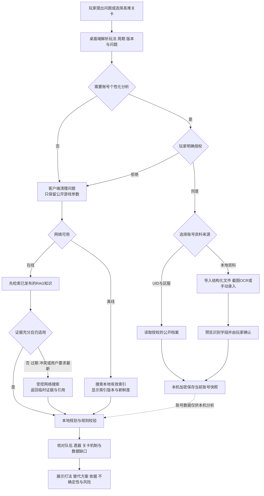
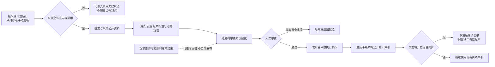

# Abyss AI

一个以账号安全为第一要求的《崩坏：星穹铁道》高难关卡规划与执行框架。

当前处于 Phase 2A：在 Phase 0–1 安全框架上加入了完全离线的合成 OCR 与战斗回放闭环。当前版本不会连接游戏、不会联网检索、不会读取账号凭据，也没有真实键盘或鼠标输入后端。

## 目标产品流程（规划中）

> 下图描述 StarHelp 的目标用户流程，不代表当前仓库已经实现联网 RAG、真实账号读取或 Windows GUI。当前能力仍以本 README 上方标注的离线模拟为准。

### 玩家查询与个性化攻略



### 公开知识采集与发布



- 账号读取需逐档案明确授权；账号快照在本机加密，账号字段及其推导信息不发送给知识后端。缺失、过期或冲突的数据会明确提示。
- 在线回答先检索已发布知识；只有证据不足、过期、冲突或用户要求最新信息时才即时搜索。即时搜索结果可临时回答并进入候选队列，不会自动发布。
- 内容审核与索引发布是分开的操作；作者优先级事件只在有价值知识最终发布后生成。作者/热点筛选独立运行，不阻塞玩家知识检索。
- 完整产品方案见 [长期开发方案.md](./长期开发方案.md)。

## 当前能力

- 不可变账号快照，以及角色—光锥—遗器绑定模型；
- 战斗方案与账号、快照、关卡绑定；
- `READY / MARGINAL / NOT_READY / UNKNOWN` 通关评估；
- 不达标账号的结构化培养方案；
- 战斗方案机器验证；
- 一次性、短时有效的人工审查授权；
- 默认拒绝的安全内核；
- 纯内存动作记录器，不发送真实输入；
- 离线规则策略与可重复测试。
- 结构化合成帧、分页 OCR、字段范围校验与冲突复核；
- `ready / not-ready / low-confidence / ocr-conflict / unsafe-screen` 五类离线场景；
- 逐动作状态转换验证和脱敏回放报告。

## 离线模拟

```bash
# 默认停在强制人工审查门
PYTHONPATH=src python3 -m abyss_ai simulate --scenario ready

# 只批准本地模拟，动作仅写入 RecordingInputBackend
PYTHONPATH=src python3 -m abyss_ai simulate --scenario ready --approve

# 其他安全场景
PYTHONPATH=src python3 -m abyss_ai simulate --scenario not-ready
PYTHONPATH=src python3 -m abyss_ai simulate --scenario unsafe-screen --approve
```

## 本地验证

无需安装依赖即可运行标准库测试：

```bash
PYTHONPATH=src python3 -m unittest discover -s tests -v
python3 -m compileall -q src tests
```

安装开发依赖后也可使用：

```bash
uv sync --group dev
uv run pytest
uv run ruff check .
```

## 安全边界

- 大模型不能直接控制输入；
- 没有有效人工授权时拒绝执行；
- 不满足最低通关标准时拒绝执行；
- 状态未知、版本未验证、窗口错误或页面非白名单时拒绝执行；
- 当前仓库没有真实输入实现。
- `FixtureOcrEngine` 只解析测试 JSON 载荷，不代表真实 OCR 精度。

完整规划见 [长期开发方案.md](./长期开发方案.md)。
