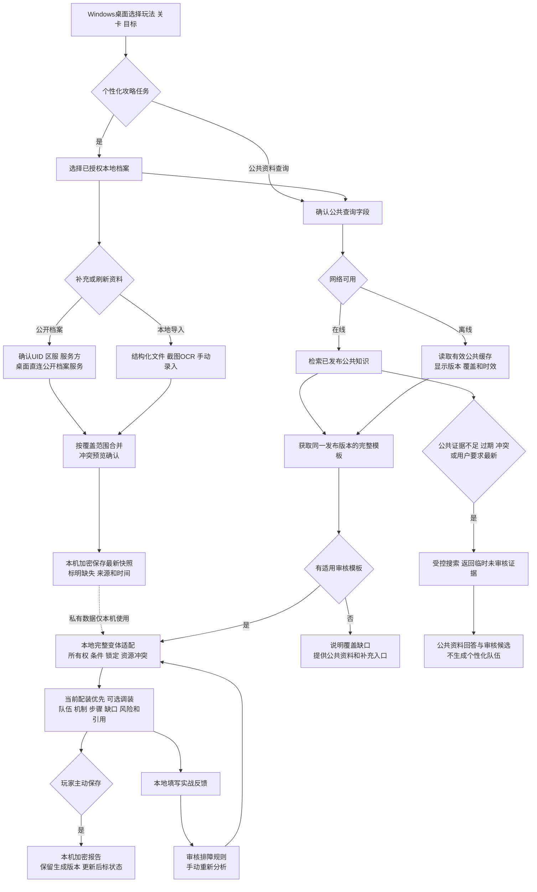
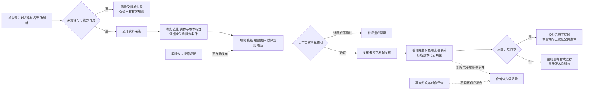

# StarHelp

面向《崩坏：星穹铁道》玩家的 Windows 桌面攻略 Agent：查询有来源的游戏资料，在明确授权后整理账号信息，帮助制定高难关卡的队伍、配装和打法。

> 当前代码仍为 `abyss_ai` 离线规划/模拟核心，含合成 OCR 和战斗回放样本。Windows GUI、真实账号读取、真实 OCR、联网 RAG 和模板推荐尚待开发。下述产品流程是已确认的开发目标。

## 开发文档

| 文档 | 用途 |
|---|---|
| [长期开发方案 v1.3](./长期开发方案.md) | 产品范围、账号边界、本地推荐、阶段、验收及前后端协调 |
| [公开知识后端方案 v0.2](./星铁公开知识后端-开发方案-v0.1.md) | 来源采集、审核发布、公共 API、部署、权限与任务恢复 |
| [SQLite逻辑设计 v0.2](./公开知识库-SQLite结构设计-v0.1.md) | 公开知识、完整模板/变体、证据、发布包及审计关系 |
| [领域词汇表](./CONTEXT.md) | 账号、装备身份、攻略模板、变体、条件与报告的统一定义 |
| [ADR-0018](./docs/adr/0018-public-knowledge-local-planning.md) | 公开知识后端与本地账号规划分离，替代旧云端匿名构筑方向 |

后端与数据库文件保留历史文件名，内容版本以文档头为准。当前产品方向以本页、长期方案及 ADR-0018 为准；历史执行模拟和 ADR 不代表目标产品开放游戏操作。

## 产品范围

- Windows 桌面直接交付，首版以结构化任务选择为主，不要求玩家安装本地大模型。
- 混沌回忆、虚构叙事、末日幻影均支持进度和攻略，优先覆盖每期最终高难关卡与主要 Boss。
- 公开档案与本地结构化文件、截图/OCR、手动录入均支持；实际数据覆盖以来源验证和用户确认结果为准。
- 后端发布人工审核的公共攻略模板、完整队伍变体和排障规则；本机匹配账号并检查硬限制，不能自由拼接替代。
- 当前配装方案优先，调装方案遵守固定/排除角色与锁定装备；未知角色只进入待确认候选，装备身份歧义不参与跨角色调装。
- 攻略注明队伍、配置条件、机制、步骤、培养缺口、引用和风险；规则排序分不表示通关概率。无适用模板时提供公共资料和覆盖缺口。

## 玩家查询与个性化攻略（规划）



- 账号字段和派生特征不发往知识后端或远程模型；UID/区服仅经确认后由桌面直连所选公开档案服务。不收集游戏密码、Cookie、会话令牌。
- 每个档案独立授权，默认手动刷新，可单独开启自动刷新；部分刷新保留未读字段与原时间，不因展示缺项推断未拥有。
- 导入先预览确认，不归档原图，软件清理自身临时副本；保存报告需主动操作，撤销档案授权时删除关联数据与报告。
- 游戏操作由玩家自行完成；首版提供研究和建议，不操作游戏。

## 公开知识采集与发布（规划）



查询优先 RAG；即时搜索只在明确条件下触发。审核与发布分别授权审计，作者/热度治理不阻塞基本知识管线。先本机验证，再邀请制服务器试用，每个用户独立身份默认只读。来源、公开档案覆盖、接口 schema、更新频率和数值阈值仍需工程验证。

## 现有离线开发基础

当前代码包含领域快照、角色—光锥—遗器绑定、方案校验、默认拒绝的安全框架、合成 OCR、纯内存动作记录和可重复回放。`READY / MARGINAL / NOT_READY / UNKNOWN` 及培养输出属于现有模拟流程；模拟分数和固定队伍不能作为真实账号推荐效果。

### 离线模拟

```bash
# 默认停在模拟审查门
PYTHONPATH=src python3 -m abyss_ai simulate --scenario ready

# 仅批准本地模拟，动作写入 RecordingInputBackend
PYTHONPATH=src python3 -m abyss_ai simulate --scenario ready --approve

PYTHONPATH=src python3 -m abyss_ai simulate --scenario not-ready
PYTHONPATH=src python3 -m abyss_ai simulate --scenario unsafe-screen --approve
```

### 开发者验证命令

```bash
PYTHONPATH=src python3 -m unittest discover -s tests -v
python3 -m compileall -q src tests

uv sync --group dev
uv run pytest
uv run ruff check .
```

这些是仓库现有命令说明，本次方案更新未执行代码测试。`FixtureOcrEngine` 解析合成 JSON，不代表真实 OCR 精度；仓库没有真实键盘/鼠标输入实现。
