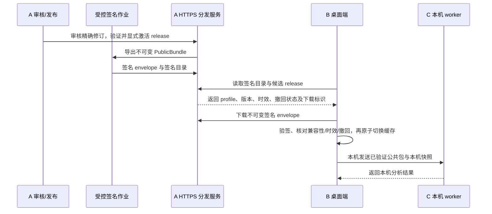

# 生产接入提案（讨论稿 v0.1）

**核查日期：** 2026-10-21
**状态：** 供用户审阅；不冻结接口、不启动 S4、不代表生产验收。
**范围：** 只讨论 A（公开知识后端）与 B（桌面端）的生产接入，以及 A 的公开资料检索与证据回答。已确认 MVP 顺序为先 Windows 本机客户端与后端验收，再邀请制共享服务；两阶段都属于 MVP。默认服务身份只读，用户负责首轮内容审核与发布。账号快照仍只在 B/C 本机链路中使用。本提案没有启用采集器、访问真实账号、创建真实审批或配置生产密钥。

## 当前实现与缺口

| 部分 | 仓库中已有的实现 | 生产缺口 |
|---|---|---|
| A 发布与分发 | SQLite 已保存来源策略/能力快照、证据、候选及不可变修订；审核绑定精确修订哈希；构建、验证、激活、回滚是分开的、需权限的审计操作。`export-bundle` 导出 A 原生 bundle；`export-distribution` 使用外部 Ed25519 私钥导出 B `PublicBundle` envelope；`verify-distribution` 可独立校验 envelope 签名、A release、C 投影、能力与依赖闭包。 | HTTP `GET /v1/releases` 发现的是 A index release 元数据；`GET /v1/releases/{id}/bundle` 返回 A 原生 bundle。HTTP 目前没有 B 签名 envelope 的发现或下载路由，也没有签名撤回/时效目录。不能把这两个现有路由当成 B/C 分发协议。私钥当前由 CLI 文件参数读取，部署时应在受控发布作业签名，线上服务只提供不可变产物。 |
| B 校验与缓存 | `PublicBundleSource`、`PublicBundleSynchronizer` 已定义发现/下载接口；同步时校验预期 release ID、签名和支持能力，再以原始验证字节写入缓存并切换当前指针。缓存最多保留两个版本。B 构造 C 请求时显式传入用途、信任公钥、A/B producer commit 与格式 profile。 | 没有实现面向 A 的 HTTPS `PublicBundleSource`。同步适配器没有验证签名目录、撤回状态或时效期限的在线协议；缓存只有本地、未签名的验证时间回执和 manifest 中可选时效字段。没有显式的 B 回滚 API；两份缓存不等于已批准的回滚行为。 |
| C 本机执行 | B 通过 `LocalPlannerProcess` 为一次分析启动固定本地 worker，stdio 通信有超时、尺寸上限和 profile 撤权取消；worker 校验请求后加载固定 C 0.4.0 wheel。C 的 producer adapter 对 A commit `dcb1e3e…` / package 0.3.0 和 B1 `103741e…` 有明确兼容项。 | C worker 是每次请求启动的一次性子进程，没有常驻 health endpoint。C 0.4.0 固定轮的 A/B1 安装回放已通过。最新 B 记录称 B2 源/打包 21 个样例及安装回滚通过，C packaged report 为 77 项检查、0 失败；根会话仍在收口最终证明，三方及生产验收仍未关闭。 |
| A 服务进程 | CLI `serve` 启动本机 WSGI 服务，默认绑定 `127.0.0.1:8765`；`GET /health` 固定返回 `status: ok`。 | WSGI 入口不是公网 TLS 终止器。当前 health 不检查数据库迁移、读写能力、签名目录或发布可用性；没有 B 对 A 服务的 start/stop 管理接口。第一阶段可由 Windows 桌面端的本机 controller 启动并监测 loopback A；第二阶段由共享主机的服务管理器控制 A，桌面端消费 HTTPS 服务。 |
| A 检索与回答 | `/v1/query` 在单个固定 release 内查实体、关卡/模板或做确定性关键词包含匹配；`/v1/public-search` 先跑本地关键词检索，无命中只返回 `triggered`。 | 无真实外部搜索 provider、语义/向量索引或答案生成器；`/v1/public-search` 明确返回 `provider_status: not_configured`、`candidate_queue: not_created`。当前能力是本地检索，不是完整 RAG 回答链。 |

**S3 现状核对：** A 的 producer commit 为 `dcb1e3ee220b85229bedc6c79d72ebe495825f37`，不可变样例 artifact commit 为 `4610573ee9720f2b5e4760a9336263362446b800`。C 0.4.0 的固定 wheel SHA-256 为 `3b5b8de8f2ef71cd07f1cfb7724cb0a1564f316860232b58728386d52c47aea2`；C 的 A 0.3.0 / B1 固定合成样例回放已通过。更新进度：B 记录的 B2 源/打包 21 样例、安装与回滚通过；C packaged report 77 项检查、0 失败。根会话仍在收口最终证明，three-party replay 与 production acceptance 尚未关闭。此状态补充不改写冻结的 S3 源码、产物或协调锁。

## 建议的 A→B 分发闭环

继续使用现有 B envelope 与 C planner profile；新增的在线传输和撤回目录应作为单独版本化接口，不能改变已冻结的 S3 样例或 A/B/C 共享契约。

### 候选接口

| 接口 | 目的与约束 |
|---|---|
| `GET /v1/distributions?profile=starhelp.local.v0.2` | 新增的签名目录读取接口，返回 release ID、A producer 版本/commit、B envelope profile、C profile、能力集、不可变下载标识、签发时间和 `valid_until`。目录还带单调递增序号及撤回的 release ID/content hash。目录签名必须能由 B 的信任配置验证，并对签名用途做绑定；是否由与 envelope 不同的 key 签名留给技术复核。B 验目录签名后再验 envelope。 |
| `GET /v1/distributions/{release_id}` | 下载该 release 的原始、不可变 B `PublicBundle` envelope；支持 ETag/If-None-Match，但响应内容必须与已签名目录中的 digest 一致。重定向、跨主机 URL、未知 profile、尺寸超限都拒绝。路由不能重新生成不同字节的 envelope。 |
| `GET /health/ready` | 新增 readiness 检查：服务版本、数据库 schema/migration 状态、可读的 active release、分发目录可用性。不得返回密钥、token、用户数据。现有 `/health` 保持 liveness 语义或逐步兼容；不要继续用静态 `ok` 表示已可生产服务。 |
| B 内部 `PublicBundleHTTPSSource` | 实现现有 `PublicBundleSource` protocol。仅请求固定配置的 HTTPS host，不带 bearer token、UID、cookie 或账号字段；提供 `discover_release(current)` 和 `fetch_release(id)`。先校验目录与兼容 tuple，再取 envelope；校验签名、exact release、A/B/C profile、能力和 hash 后才激活。 |
| B 内部 `PublicBundleCache.rollback(target_release_id)` | 只在目标是本地已验签、未撤回、未过期且兼容的缓存版本时原子恢复。新版本验签或兼容性失败时保留当前版本；已撤回版本禁止回滚。在线撤回不可达时，界面显示“撤回状态未知”和上次核验时间，不伪称已确认安全。 |
| B 本地 `KnowledgeBackendController`（第一阶段） | 候选 `start() / health() / stop(grace_seconds)` 进程控制契约：固定 executable/参数、无 shell、只绑定 loopback；start 需等待 readiness，health 返回 pid/版本/schema/active release 这类非敏感状态，stop 先请求正常结束、超时再结束进程。当前 B 没有这个 A 进程控制器，C 的 one-shot worker 不能替代。第二阶段由共享主机的服务管理器负责 A 的启动/停止/健康探测，B 只访问 HTTPS；这符合已确认的两阶段 MVP 顺序。 |

签名目录建议至少包含 `schema_version`、`sequence`、`issued_at`、`valid_until`、受支持的 producer/profile tuple、latest release 的 envelope digest、撤回列表和签名用途。目录及撤回声明必须有 B 可验证的签名，且签名用途绑定，避免跨用途重放。单一 key 配合域分离签名与独立 key ID 的方案、或使用两把 key 的方案，作为待技术复核选项；这里不预设必须使用两把生产 key。轮换、恢复和撤回信任锚流程要先形成可审阅方案。目录 TTL 与最大离线使用时长也是待决运行策略，先提供配置建议与失败行为，再请用户确认具体窗口。

兼容性以精确 tuple 白名单判定：A commit + package version + B envelope profile + C producer adapter profile/wheel hash + B snapshot profile。不得仅凭 `schema_version` 或兼容字符串推断支持。首次在线对接应先用当前固定的 S3 artifact 和测试公钥跑通传输；测试公钥不能进入生产信任锚。B 已记录 B2 21 样例与安装回滚通过，C packaged report 也已报告 77 项检查通过；根会话最终证明收口前不声明整体验收。

## 公开资料 RAG 与证据回答

公开 RAG 是已确认的 MVP 要求，应在两阶段中提供检索与证据回答。先实现与来源无关的完整通用路径，用 synthetic fixtures 和已获准的人工证据验证；真实来源的许可只控制对应 collector、内容留存和展示，不阻塞通用 RAG 实现。通用实现支持结构化/关键词检索与语义检索选项，并用可复现语料评估质量与运行代价；算法取舍属于技术复核，不作为是否建设 RAG 的用户决策。

1. **问题输入：** 使用单独的 public question schema，只接受公开问题、游戏版本/模式/周期/关卡等公开 scope、结果数上限。不允许 UID、账号快照、角色拥有/面板/装备、报告、Cookie/token 或从账号派生的过滤条件。A 不接收 B 的个性化数据。
2. **检索：** 在指定 `index_release_id` 上做结构化字段、确定性关键词与语义检索候选，并保留可解释排序/过滤理由。实现和 fixture 评估不依赖任何单一真实来源。只有某来源的条款限制文本处理或派生向量时，才限制该来源对应的 embedding 输入和留存；这项来源授权检查不取消通用语义检索能力。结果必须保留证据 ID/revision、原 URL、locator、内容 hash、来源状态和发布时间/观测时间。
3. **临时来源结果：** 命中已允许且能力已核实的来源后，临时证据默认只在本次回答上下文中使用。内容是否可缓存、可摘要、可生成向量、可展示原文，分别由该来源的 policy 明确允许；HTTP 传输成功或 `VerifiedJSONSourceAdapter` 的 capability snapshot 不等于来源授权或完整覆盖证明。
4. **回答：** 只用检索到的公开 evidence 生成回答；每个可核查事实带来源 URL、标题/定位符和版本/日期。回答指出观点冲突与信息缺口；证据不足时明确回答未找到可靠依据，不补写事实。来源状态未知、过期或撤回时，不把内容当作当前有效答案。模型 provider 使用同一 public-only 输入边界；具体远程目的地与费用额度在配置和成本方案可审阅后再确认，不阻塞检索与证据回答通用实现。
5. **候选、审核、发布隔离：** 一次搜索/回答不得自动创建 candidate。需要沉淀时，操作者从回答中明确选择事实和证据，再单独调用 candidate 创建；candidate 形成不可变 revision/hash；reviewer 对精确 hash 作出审核；publisher 再独立 build、validate、activate。回答引用不代表候选获批，审核也不等于发布。

### 最小留存建议

来源 policy 允许后，优先只保留规范 URL/稳定外部 ID、标题、署名所需的公开作者标识、精确 locator（章节/时间戳/JSON pointer）、游戏版本、发布时间、首次/最近观测时间、原文 hash、审核状态及最短必要 excerpt。A 当前 evidence 记录已有 URL/title/author/excerpt/locator/license/scope 字段，并限制 excerpt 大小；生产默认 excerpt 可进一步按每个 source policy 收紧。

未获明确许可时不保存整篇攻略、音视频、转录、图片/游戏素材、评论或完整镜像。embedding 也是源内容的派生存储，只有在许可覆盖后才加入。引用本身用于可追溯，不等于获得复制、缓存或再发布权。用户主动给出的内容也需记录其来源和使用授权范围。

## 候选来源核查（截至 2026-10-21）

这里只检查第一方/官方文档与仓库说明，没有调用任何候选数据 API、没有登录或使用凭据。文档中没找到接口或许可，不代表断言该来源不存在；状态应保持 `unknown`，等待明确材料。

| 来源 | 本次核查到的材料 | 接入建议 |
|---|---|---|
| HoYoverse 官方 HSR 公告/角色页 | 官网发布版本公告、角色说明，可作人工核验后的 canonical citation；本次未核实可供第三方批量同步的机器接口或批量复用许可。[官方公告](https://hsr.hoyoverse.com/en-us/news/166468)、[角色页](https://hsr.hoyoverse.com/en-us/character)、[服务条款](https://hsr.hoyoverse.com/en-us/company/terms)。 | 可先手工录入最小事实并附官方链接、具体版本/发布日期和 locator；不自动抓取或镜像。正式自动同步前要确认许可和接口。 |
| Nanoka `static.nanoka.cc` | 维护者 README 记录静态 JSON API 和 beta 数据，并声明数据版权属于原始数据方与 HoYoverse、仅供学习研究；仓库 MIT license 标的是 skill 代码。[README](https://github.com/Run2zZ/hsr-nanoka)、[schema](https://github.com/Run2zZ/hsr-nanoka/blob/main/references/schema.md)、[代码许可证](https://github.com/Run2zZ/hsr-nanoka/blob/main/LICENSE)。 | 可用于离线 schema 评估；生产导入保持禁用，等待数据许可、再发布/缓存条件、频率和 beta 范围的书面澄清。即使许可获准，也按版本固定数据并仅留必要字段、原 JSON pointer 和 hash。 |
| Mar-7th/StarRailRes 与 DimbreathBot/TurnBasedGameData | StarRailRes README 列出多类 JSON 索引，并把游戏数据来源指向 StarRailData；仓库页面标 AGPL-3.0。StarRailData README 将自身描述为 HSR release data，并欢迎工具/网站致谢，但没有授予游戏数据或素材的生产再分发权。[StarRailRes README](https://github.com/Mar-7th/StarRailRes/blob/master/README.md)、[StarRailRes LICENSE](https://github.com/Mar-7th/StarRailRes/blob/master/LICENSE)、[StarRailData README](https://github.com/DimbreathBot/TurnBasedGameData/blob/main/README.md)。 | 保持禁用直到厘清 AGPL 对仓库代码的范围、源数据/美术素材权利和可否服务端再发布。不要把 AGPL 仓库代码许可外推成原始游戏数据许可；不下载或保存图片素材。 |
| Bilibili 攻略/开放平台 | 官方用户协议 §5.6(3) 规定自动程序获取平台服务、内容或数据前需明确书面许可。[用户协议](https://www.bilibili.com/blackboard/protocal/licence.html)。Open Platform 文档显示账号授权、公开用户信息、稿件管理和用户授权数据等应用能力；开发者协议把用户数据限制在关联 UP 主明确同意的范围和应用目的内。[Open Platform](https://open.bilibili.com/doc)、[开发者协议](https://open.bilibili.com/agreement/developer-service)。 | 不启用公开攻略搜索/爬虫。只有官方确认具体 API 权限、字段、稿件/转录范围、存储展示、保留期限、频率、用途和托管地域后再评估；仅有 API access 不代表有攻略内容再发布权。 |
| HoYoLAB / 米游社 HSR Wiki | HoYoLAB 官方站链接社区条款和隐私政策；本次动态条款正文无法读取，也未在所查官方材料中找到一般公开搜索/攻略采集的开发 API。单篇 Wiki/社区页面的署名或转载提示应逐页核对。[HoYoLAB](https://www.hoyolab.com/?v=157)、[HoYoverse 隐私政策入口](https://hsr.hoyoverse.com/en-us/company/privacy)。 | 暂作人工 click-through 引用，不镜像攻略/评论。向 HoYoverse 确认可用 API、自动访问、excerpt/缓存和展示条款后才新增 adapter。 |
| Mihomo / Enka 等玩家档案 | 这是 B 的逐档案资料流，不是 A 的公开知识来源；公开 profile 仍含用户相关数据。 | 留在 B/C 授权的本机链路；A RAG 不采集、不索取 UID、不存档案或派生信号。 |

## 交付顺序建议

1. **落实第一阶段本机路径：** 用 synthetic fixture 定义 `PublicBundleHTTPSSource`、签名目录、撤回/过期验证、兼容性拒绝和双版本本地恢复；实现 B `KnowledgeBackendController` 与 A readiness health，使 Windows 桌面端能安全启动、探测和停止 loopback A。
2. **完成第二阶段共享服务路径：** 由主机服务管理器托管 A，经 HTTPS 提供只读服务身份；B 接入同一签名目录/下载/撤回协议。两阶段按既定顺序纳入 MVP，A/B/C owner 复核具体协议与实现。
3. **完成公共 RAG 通用路径：** 用 synthetic fixtures 和已获准人工证据建立 chunk/retrieval/ranking/answer/citation/abstention 管线，支持并评估关键词与语义检索。用户 review 内容与证据；模型 provider 做成配置项，远程目的地与费用方案交付审阅后再确认。
4. **逐来源开放：** 每个来源单独核对条款/许可、接口、覆盖、存储、频率和撤回流程；只有 `allowed` policy 与 dated/verified capability 成对存在才允许 adapter。变更条款则暂停该来源，已发布内容走 disable/撤回和重建 release。
5. **独立生产门：** 配置 production signing/catalog trust、key rotation、TLS、监控备份、部署恢复、B2 host replay、客户端离线策略和真实人工内容审核。未逐项通过前仍是集成候选，不称生产验收。

## 后续需用户确认的操作条件

这些事项不阻塞已确认的两阶段 MVP 或通用公开 RAG。先交付来源配置、provider 选项、密钥管理和离线运行策略供审阅，再请求对应的真实启用或运维决定。默认只读服务身份与用户作为首轮审核/发布负责人已确认，不再列为问题。

1. **真实来源启用：** 每个来源分别提交许可/API 证据、字段范围、留存/展示/频率/撤回配置后，再确认是否启用。当前来源表只支持“人工官方事实可先准备”的技术方案，不代表自动采集已获授权。
2. **远程模型配置：** 先提供 local/remote provider 配置、public-only payload 白名单、用量上限与成本估算；随后确认具体远程目的地、预算和是否启用。此决定不阻塞 RAG 检索/证据回答通用路径。
3. **生产密钥运维：** 先交付 release/catalog 签名用途、信任根更新、轮换、恢复及审计配置方案，再确认实际密钥保管人和生产配置操作。单 key 域分离与两 key 方案都可进入技术复核，不能预设必须两把 key。
4. **新鲜度与离线运行：** 先提交目录有效期、最长离线使用时长、无网络时的提示/降级、过期与撤回时的缓存恢复方案，再确认具体数值窗口。建议始终展示上次核验时间和在线状态。
5. **来源特别条件：** Bilibili 自动获取须先有书面 API/内容许可并明确用户数据托管地域；审阅材料为官方用户协议 §5.6(3)、Open Platform 能力目录与开发者协议。其他真实来源也须按其独立 policy 和 capability 证据处理。
6. **真实账号验收：** 先交付 B/C 本机授权、数据范围、撤权与验收步骤供审阅，再由用户明确确认具体账号操作。账号快照与派生信息始终只留在 B/C 本机链路，不发送给 A。

## 技术复核项（不作为额外产品门）

- 本机 `KnowledgeBackendController` 的 executable 位置、服务托管边界、就绪探测和升级/停止行为；共享阶段由主机服务管理器托管。
- 目录/撤回签名是否复用 release key 或采用独立 key、签名域分离与轮换实现；无论方案如何，B 必须验证签名、用途、序号和有效期。
- 关键词与语义检索的评估语料、排序和实现代价；公开 RAG 本身是已确认的 MVP 要求。

## 依据与仓库锚点

- A 实现核查基于当前 A `codex/mvp-knowledge-backend` 提交 `0e8a6f7`，重点文件：`packages/starhelp-knowledge/src/starhelp_knowledge/http.py`、`cli.py`、`distribution.py`、`sources.py`、`service.py`、`migrations/001_initial.sql`。
- B/C 实现状态以只读仓库核对、S3 固定证明及本次根会话进度为准：A producer `dcb1e3e…`、artifact `4610573…`；C source `f627590468154cc8622dad8647fefe9f6fd3c4ee`、wheel SHA-256 `3b5b8de8f2ef71cd07f1cfb7724cb0a1564f316860232b58728386d52c47aea2`；B1 source `103741e02c90ac672017f783058bdd8dacae982e`。共享协调锁是先前状态快照；最新进度为 B2 21 样例/安装回滚通过、C packaged 77 项检查无失败，根会话仍在收口最终证明。冻结 S3 契约、源代码和产物没有被修改。
- 来源网页与仓库页面均于 2026-10-21 检查；上表的链接是来源材料，不代表授权或法律意见。页面可变，启用 collector 前需重新核对当前条款并保存对应版本/日期及授权证据。
