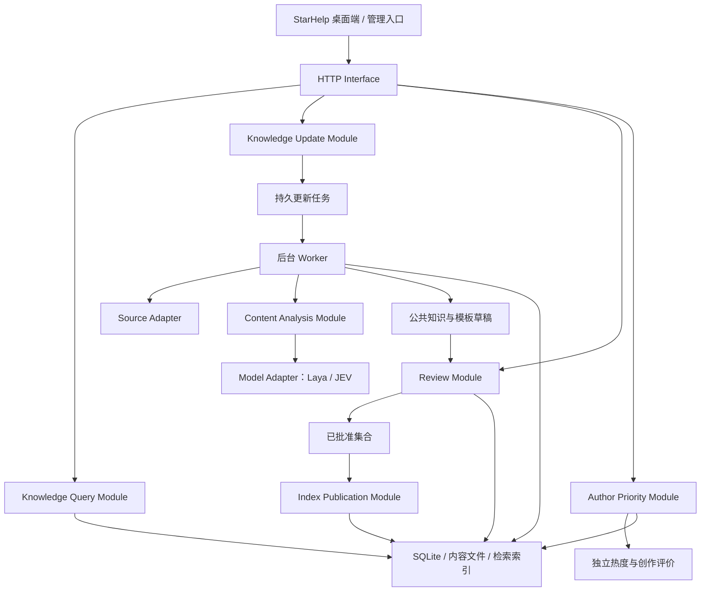
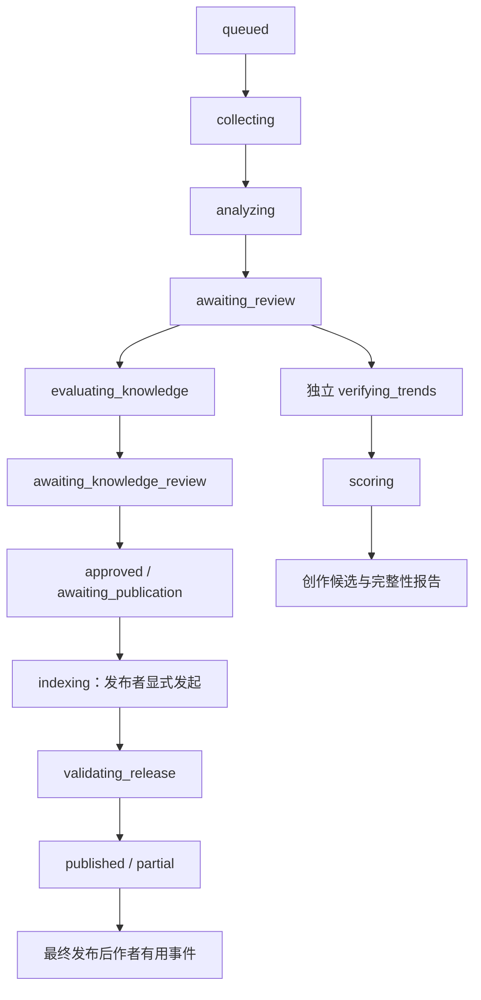

# 星铁公开知识后端开发方案

> 状态：方案定稿 v0.2；产品边界和开发基线已确认，接口与技术选型仍须验证；本轮仅更新规划文档。
> 日期：2026-10-14
> 上位需求：《长期开发方案.md》。
> 数据设计：《公开知识库-SQLite结构设计-v0.1.md》。
> 标记规则：用户确认的内容标为“已确认”；其余技术路线和接口细节均为设计建议，实施前仍须验证。
> 文件名保持 v0.1 以兼容既有链接；文档内容版本以本页状态为准。

## 1. 已确认范围

1. 首版在本机运行，验证后迁移到服务器；本项目作为 StarHelp Windows 桌面 Agent 的公开知识后端。服务器先面向受邀小规模测试。
2. 以 Nanoka 建立完整人物、怪物基础资料库为目标；实际枚举、覆盖和许可待验证。测试服和未实装资料与正式服分开使用。
3. 米游社、B站按配队、角色攻略、怪物与战斗机制、实用技巧分别搜索；同站合并去重后，每轮最多二十条。
4. 每站基础名额为重点作者八条、普通作者十二条、总计最多二十条，同一作者每轮最多三条。重点作者缺额可转普通搜索，无重点作者时最多二十条均来自普通搜索；普通桶不足不反向补给重点作者，允许不足二十条并报告缺口。
5. 知识质量审查与内容创作治理是独立管线。知识 RAG 可先交付；热度、作者评分或选题模块未完成或失败，不阻塞公共知识检索与合格知识发布。
6. 关键词包括内容类别、关联对象、战斗问题、适用范围、热度查询词；同时提取可操作方法摘要与原文依据。
7. 选题和知识保留分别评分；作者优先级占最终选题分 5%，其余 95% 为选题基础分。权重沿用数据库设计稿。
8. 使用 SQLite；提供版本化基础资料、知识证据、机器可读攻略模板、混合检索和可回滚索引。后端严格不接收玩家 UID、账号字段、快照、库存、队伍现状、账号推导特征、反馈或报告；账号资料及个性化分析全部留在 StarHelp 本机。
9. Laya 暂作采集后分析/筛选的主决策模型，JEV 暂作次级候选。JEV 的准确身份、兼容方式和性能尚未确定；“次级”是当前方案中的角色定位，不是实测性能结论。公共回答使用独立的 Agent Provider 契约；桌面 MVP 不安装本地 LLM。
10. 热度数据缺失时，完整与部分数据分组展示；部分组按内容发布时间排序、缺失不填零、不重新分配权重、不计算综合选题分。发布时间未知的条目单列并标明，实用知识继续独立评价。
11. 人工逐条审阅批准公共知识、攻略模板、完整队伍变体和有限排障规则，发布者通过独立操作发布索引。审核通过不自动发布，未校准概率不能代替批准。
12. 初始重点作者名单由维护者手工指定，使用稳定平台作者 ID，不因同名跨平台合并；允许人工提升、降级和停用。有用知识仅在人工批准且实际发布后产生一次幂等、可追溯作者事件，无模型暂定事件，初期不自动衰减。
13. 按来源设置更新计划并支持手动刷新；本机后台更新须明确开启。查询先使用知识库，证据不足、过期、冲突或用户要求最新时才受控搜索。临时未审核证据可支持公共回答并排队整理，不生成个性化方案、不自动永久发布。
14. 首版攻略模板同时覆盖混沌回忆、虚构叙事、末日幻影，先保障每期最终高难关卡；完整覆盖取决于经过审核的实际资料，缺项明确报告。桌面按完整队伍变体本地适配，不自由组合替代。

### 1.1 账号和公共请求的硬边界

公共 API 仅允许白名单字段：玩家主动选择的公开游戏版本、资料环境、实装状态、玩法、周期、关卡、公开问题类型、目标奖励/分数条件和公开资料实体 ID，以及分页、索引版本等协议字段。不得从账号快照生成“已拥有角色 ID 列表”“练度范围”“可用装备清单”“失败分类”或其他推导摘要发送后端，也不得将它们编码进搜索词、路径、请求头或日志。公开实体查询须来自玩家明确的资料查询，不得携带由账号筛选出的实体集合。

桌面主交互为结构化任务，自然语言仅在本机作补充。客户端不能可靠分离混合输入时，应让玩家确认公开字段；不发送会话原文、截图、OCR 结果、已保存报告或战斗反馈。服务端拒绝未知/越界字段，不靠“默认不入库”代替拒绝；公共生成 Provider 也仅接收经过校验的公共字段及公开证据。

账号公开档案由桌面在 UID/区服 + 明确确认后直连经验证的公开档案服务，数据来源和出站字段在客户端授权界面展示；请求不经 StarHelp 知识后端代理。MVP 不收集游戏密码、Cookie、会话令牌，不使用游戏二维码登录授权。字段不足通过本地结构化文件、截图/OCR 或手动输入补充，均不进入本后端。此边界没有另行同意后上传账号摘要的例外。

## 2. 本机与服务器部署路线

建议首版采用单个后端项目，包含 HTTP 请求进程和一个独立后台 Worker，共用本地持久存储。通过明确的 Module 与 Interface 分离职责，不拆成多个独立微服务。



本机阶段建议只监听 `127.0.0.1`，使用本机应用鉴权，数据库和索引放在配置的数据目录。桌面管理本地后端的启动、健康检查与停止；开发环境允许独立运行。Laya 如采用本机部署，是知识维护端的独立推理进程，不是要求每位玩家安装的账号分析模型。

服务器阶段保持请求契约一致，补充 HTTPS、服务身份、权限管理和运维入口。受邀者具有独立服务身份，默认 reader；updater、reviewer、publisher 按职责分别授予。小规模阶段可由同一维护者兼任，但动作、主体和审计记录分开；来源和成员管理仅授权管理员可执行。管理与复核入口位于 Windows 桌面软件受保护的管理区域，界面隐藏不能代替服务端权限检查。SQLite 文件归一个部署实例管理，避免多个机器直接共享同一个活动文件。服务器采用何种模型部署另行评估；账号字段及推导信息在本机和服务器两阶段均不进入本服务。

后台更新默认关闭，用户或维护者明确开启后按来源策略运行；手动刷新受同样的权限、许可和频率约束。来源新鲜度按基础资料、攻略、当期关卡等类别分别制定，具体间隔由实际能力验证后确定，不在此稿虚构统一更新小时数。

建议技术候选：Python 3.12 与 StarHelp 保持一致；HTTP 可选 FastAPI + Pydantic；数据库映射/迁移可选 SQLAlchemy + Alembic。这些是建议，未安装依赖或验证具体版本。

不要用 HTTP 请求内的临时后台回调承担整个更新流水线；任务状态、阶段结果与人工停点必须能跨进程重启恢复。数据库写入采用短事务，联网、模型推理和人工等待均发生在事务外；首版由一个 Worker 调度更新写入，检索请求独立读取。

## 3. Module 与 Interface

| Module | 调用方需要知道的 Interface | 内部负责的行为 |
|---|---|---|
| Knowledge Query | search、resolve_entities、get_entity、get_stage、get_template | 仅公共白名单请求；固定索引快照、版本/周期过滤、别名解析、混合检索、完整模板与证据状态 |
| Public Evidence Search | search_public、answer_public | 按明确触发条件进行受控搜索，标注临时证据与许可/时效，生成公共回答并排队待整理，不接受账号信息 |
| Knowledge Update | start、status、retry_failed、cancel | 采集策略快照、配额、去重、阶段调度、检查点、失败隔离、复核停点 |
| Review | list_candidates、apply_review、continue_run | 原结果保留、人工变更、并发冲突检测、确认范围、重新评价触发 |
| Content Analysis | extract、evaluate | 结构化提取、事实与建议区分、质量维度评价、证据定位、输出校验 |
| Author Priority | list、set_manual_state、record_published_usefulness | 人工初始名单；最终发布后的幂等有用知识事件、人工调整、可解释优先级和名额选择 |
| Index Publication | build、validate、activate、rollback、get_manifest、get_package_status | 批准与发布分离；完整模板/变体/规则成员清单、来源权限重查、公共包校验和原子切换 |

HTTP 层只完成输入校验、权限检查、错误转换与调用。不同来源和模型通过 Adapter 变化，配额、版本隔离和入库门槛不能由来源 Adapter 各自决定。

## 4. Source Adapter 与 MCP

### 4.1 三类不同的采集 Interface

**基础资料 Adapter**：discover_entities(cursor)、fetch_entity(external_key)、check_changes(checkpoint)。返回实际发现清单、原始证据定位、环境、版本、覆盖与错误状态；不承诺没有枚举证据的“完整”。

**攻略 Adapter**：search(query, order, cursor)、list_author_content(author_key, cursor)、fetch_content(content_key)、fetch_metrics(content_key)。返回规范化标题、链接、稳定站内 ID、作者 ID、发布时间、正文/字幕类型、流量可用状态。

**热度 Adapter**：query_trend(query, time_window)。返回真实数据、查询口径与可用状态；不通过其他平台热度伪造目标平台指数。

能力注册表记录：是否支持时间排序、可分页范围、最大结果数、正文/字幕/指标覆盖、是否需要来源访问授权、请求频率和最近验证时间。能力包括 declared、verified、partial、unavailable；工具说明只能证明 declared，真实接入测试后才能标 verified。

原文保存默认采用许可范围内的最小必要摘录 + 规范化 URL + locator + 内容哈希，保留资料类型与覆盖说明；全文、页面快照或完整字幕仅在来源许可明确允许时保存。未知许可内容隔离待核实，不能因技术上可抓取就用于正式发布。结构化提取和证据位置须能追溯到实际取得的内容，视频简介不能标成完整字幕。

### 4.2 已知接入情况

| 来源 | 当前依据 | 方案中的处理 |
|---|---|---|
| Nanoka | 先前只读网页检查未得到可读正文，完整枚举方式未验证 | 基础资料 Adapter 待验证；首次建立对象清单与覆盖报告，再全量摄取 |
| 米游社 | 先前页面要求 JavaScript；攻略搜索和正文获取方式未验证 | HTTP、浏览器或 MCP 接入待选；先核对公开可访问字段与发布时间排序 |
| B站 | 本会话已有 MCP 工具说明：视频搜索最大十条、综合排序；作者视频列表可返回最新页；可读取元数据、字幕等 | 可用作待验证的 Adapter。现有搜索不能证明站内最新二十条，必须补充时间排序发现能力或明确采集覆盖不足 |
| 三个指数平台 | 尚未核对可用数据入口、范围和授权条件 | 各自接入与可用性独立验证；不可用时保留待验证状态 |

B站工具说明不等于已配置来源凭据或已通过真实访问。该 MCP 目前依托 Codex 工具环境；后端脱离 Codex 独立运行时，还须验证能否作为独立 MCP Client 调用对应服务，不能把本会话工具名当作可部署的 Python 库。

“最新二十条”指相应攻略搜索范围内、按已确认作者配额取得的最新相关内容。搜索按时间排序、分页深度和发现覆盖须有证据；只对综合排序结果重排时间，最多能称“已发现候选中的最新”，不能伪装为完整满足该要求。

### 4.3 MCP 与代理

MCP 可以作为某个 Source Adapter 的接入实现，无需强制每个网站先建 MCP。已存在、可验证且能独立部署的 MCP 优先评估；没有合适服务时再决定其他接入方式或自行封装。

后端显式配置来源流量代理、模型文件下载代理与本机访问豁免，敏感代理认证放在受保护配置中。本机 HTTP、Laya 与本机 MCP 通道应绕过外部代理；不同客户端是否实际支持代理要逐项验证。Codex 的代理配置不能当作后端进程已自动继承的证据。

一个来源失效、限流或需要重新登录时停止该来源任务，其他来源可继续；不得改用其他账号或共享凭据补缺。

## 5. 模型职责与降级

正文结构化提取与 Laya 的决策任务分开。提取器先产出带原文定位的角色、怪物、版本、条件和可操作方法；随后 Laya 接收有限的结构化状态与明确问题，使用 choice、score、noul 做分类、等级评价及保留判断。

Laya 是决策模型，不直接承担联网采集或证明游戏事实正确。机制准确性要结合基础资料和证据比对；模型无法判断时输出 unknown / needs_review。提取器可由规则与合适的语言模型组成，具体 Provider 待选。

JEV 暂留作 Laya 的次级 Adapter：只有身份、输入输出和能力验证后才启用。建议仅在主模型不可用或对应能力缺失时尝试备用，不因主模型给出不喜欢的结论而反复换模型。备用模型结果保留其名称、版本、校准状态；不同模型结果不能默认同口径。

模型访问只限明确配置的推理 Interface；来源正文作为数据，不允许其添加工具调用、修改来源策略或改变入库门槛。模型异常、超时、输出缺字段时记录错误，不补造有效决策。

公共回答 Provider 与 Laya/JEV 的候选分析接口分开。公共生成只能解释经返回的公开证据，不读取本机账号、不生成账号适配结论；无需即时生成时可直接返回结构化资料与引用。临时搜索结果标明未审核、来源、时间和适用范围，与正式知识模板区分。

### 5.1 可交付给本地规划器的公共模板

自然语言正文、RAG 切片和攻略模板分别承担解释、检索和确定性匹配。检索命中片段不能直接成为可执行规则；客户端取得完整、经人工批准且进入同一发布清单的模板后，才进行本地适配。机器模板、完整队伍变体和有限排障规则均作为版本化知识修订审阅；内容或适用条件改变后形成新修订并重新批准、发布。

以下是最小语义范围，字段名和最终 JSON schema 属于工程契约设计：

| 模板部分 | 必需语义及本地处理边界 |
|---|---|
| 身份与兼容 | 模板/知识稳定 ID、修订 ID、schema 版本、所需客户端能力、有效状态、所属 index_release_id；未知 schema/能力不执行，只能展示公开资料 |
| 适用范围 | 游戏版本、环境、实装状态、玩法、周期、关卡修订、实际分区和目标奖励/分数条件；不按同名跨周期套用，不自行猜最终关卡 |
| 完整队伍变体 | 一个 variant_id 对应完整各分区队伍、槽位、角色稳定 ID、光锥/遗器要求、联合约束；变体内角色与装备条件必须相互一致 |
| 可判断条件 | 条件 ID、主体、属性 ID、允许的比较运算、目标值/单位、all/any 等有限组合、必需/建议、证据引用；本地匹配 satisfied/unsatisfied/unknown 与证据可信 confirmed/suggested/unknown 分开 |
| 替代边界 | 审核列出的完整队伍变体包含替代后的全部条件、装备和打法；不得把不同槽位的替代选项自行组合成新队，也不接受模型或文本携带的任意脚本 |
| 打法步骤 | 步骤顺序、角色槽位、动作/机制引用、触发条件、技能点/终结技原则和风险说明；不会逐行动模拟或保证通关 |
| 培养与成本 | 与要求条件关联的目标值、培养差距判定依据、适用版本；成本计算需要完整消耗规则与适用前提，缺数据明确未知。玩家当前值、库存和优先级计算只在本地 |
| 有限排障规则 | 经审核的条件重查清单、可改选的已审核完整变体、培养缺口与证据；反馈只能在本地驱动这些动作，不能临时发明队伍、规则或上传反馈文本 |
| 证据与批准 | 每个关键条件、变体、步骤和排障规则关联 claim_key、证据 ID、URL、原文定位、许可、时间、范围和复核记录；存在关键冲突或未知必要条件时不可标为已适用 |

本地以确认拥有的角色形成主方案，当前配装优先，调装须遵守固定/排除角色与锁定装备；没有可靠装备实例 ID 且存在身份歧义时，不进入跨角色调装。玩家每次选择目标，客户端可记住上次选择。候选排序依次考虑硬限制、适配程度、证据和调整成本，不把规则评分当通关概率；每个结论标明依据、缺项、时间和不确定性。没有适用模板时仅返回公开资料与数据/培养缺口，不生成貌似适配的方案。

上述账号匹配、排序、报告和反馈状态都是桌面职责。后端按公开关卡范围提供完整模板集合，不按拥有角色筛选，不接收本地条件满足状态。知识后端只提供公开的成本规则；本地数据完整且规则适用时才计算成本，其他情况以差距和优先级为主。

## 6. 更新任务状态与人工调整

每次更新固定采集规则、评分规则、模型配置与作者优先级快照；后续配置修改不悄悄改变运行中任务。



failed、cancel_requested、cancelled 和 blocked 是并列异常状态，不在正常阶段之间任意跳跃。blocked 用于来源配置、必要授权或质量信息等待，不把它冒充成功。知识主线与热度/创作支线分别记录状态；后者等待或失败不得阻塞合格知识的审核与发布。

运行状态与单个条目状态分开：条目可以 skipped、needs_evidence、trend_partial、approved、rejected 等；一个来源失败不必使所有条目失败。对外同时返回当前阶段、各来源状态、待处理数、失败数和人工行动要求。

复核页展示标题/链接、作者、类别、对象、版本与环境、可操作方法、原文依据和模型筛选理由。用户可修改标签、范围和是否验证。

继续前须满足：所有候选已确认或明确跳过；人工修改基于同一候选修订；未解决的关键版本/实体歧义从正式流程隔离。不能仅因点击按钮将未确认候选默认为通过。

知识草稿评价后进入 awaiting_knowledge_review。人工逐条批准、拒绝或要求补证据，模板、完整变体和排障规则的复核目标明确；批次中每条知识都有明确处理结果后，已批准集合进入 awaiting_publication。被批准条目才具备发布资格；补证据条目隔离等待，不阻止已批准条目形成可发布集合。发布者独立发起构建、校验和激活；批准与发布分别记录，批准不能绕过发布前的来源和有效性复查。概率校准完成也不会自行启用自动发布。

复核采用候选 review_revision_no 做乐观并发检查。提交过期版本返回 conflict，不能覆盖其他窗口的修改。后续改动影响版本、关键词或证据时，相关热度查询和评分标记失效，只重做受影响阶段，保留旧评价。

任务保存租约、检查点与阶段产物引用；Worker 重启只恢复未完成且租约失效的任务。网络请求不持有数据库事务。重试按阶段产物和幂等标识去重，不能重复作者加分或重复发布。

取消只停止后续执行和允许取消的活动操作，已采集记录保留审计；已发布索引需要独立回滚，取消不等于删除历史知识。

基础资料更新与攻略复核是两个子任务：基础资料完成校验可建立资料索引，激活仍由有权限的发布操作完成；攻略停在待复核时，不阻止已验证基础资料更新。最终运行摘要明确哪些子任务已发布、哪些仍待复核。

每站先将各类别候选合并、同站去重，再按该轮重点作者快照分桶：重点基础名额八条、普通基础名额十二条；重点缺额只允许转普通，总量最多二十条。普通内容不足、单作者三条上限或来源发现不完整导致缺额时记录原因，不反补重点桶、不重复凑数、不悄悄放宽作者上限。跨站转载保留出处和证据，但发现/配额去重口径需在来源契约内明确。

受控搜索形成单独的短期候选证据集合，记录 TTL/有效状态、许可与来源范围；可用于公共回答，不属于模板发布集合。进入长期知识库必须重新经历正式整理、人工批准和发布。临时检索失败可返回已发布证据和降级状态，不能绕过审核补造正式模板。

## 7. 流量缺失、排序与知识保留

热度验证状态区分为：完整可用、部分可用、不可用、查询不匹配、失败。三个平台的数值需先按各自口径规范化，时间窗口和词匹配明确，不能直接加总裸指数。

已确认的缺失数据处理规则：

- 完整数据条目计算已确认的选题分。
- 部分数据保存已知维度与可用性，不把缺失填零，也不自动重新分配缺失权重。
- 完整与部分数据分组展示；部分组按内容发布时间排序并标明缺少的指标，不计算综合选题分。发布时间未知者单列，不用抓取时间冒充发布时间。
- 技巧和配队的知识质量评价可继续；热度缺失影响选题热度结论，不自动否定实用知识。

以上降级路线和部分组按时间排序已确认，不能在实施时把部分组改为新的隐含权重。

已确认的评分规则继续保留：选题基础分由热度与趋势 30%、原内容流量 20%、实用价值 25%、新颖性 15%、版本时效性 10% 组成；最终选题分 = 95% × 选题基础分 + 5% × 作者优先级规范化分。知识保留价值由准确性 30%、证据充分程度 25%、可复现性 20%、条件完整性 15%、补充价值 10% 组成。分数、入库概率与本地攻略匹配排序是不同概念；不能将保留分除以一百当概率，也不能把选题热度当作游戏事实可信度。

知识入库必须满足版本、证据、来源和冲突门槛，再参考模型评价或经校准概率。模型产生入库候选，最终批准由人工完成；自动发布不属于本基线，不能因未来具备校准数据就自行启用。筛选时的人工确认、知识最终批准、索引发布是三种不同动作，前者不自动替代后者。

有用内容仅在知识已经人工批准且实际进入已激活发布版本后，对作者产生一次可追溯、幂等事件；以稳定的去重知识/原内容依据关联发布记录，重试、回滚再激活或多条近重复内容不重复加分。模型筛选、候选人工确认和仅批准未发布均不产生作者加分事件。初期不自动衰减；精确幅度、归一化和校准样本待后续验证，管理员可人工提升、降级或停用并记录原因。

初始重点作者名单手工配置，每项绑定平台 source_id + 稳定 external_author_id，显示名只是展示字段。跨平台同名不合并，不因缺少初始名单自动创建伪身份；名单变化不改变运行中已固定的作者快照。

## 8. HTTP Interface 草案

路径采用 `/v1`；以下是契约设计，不表示端点已经实现。

| 方法与路径 | 用途 | 权限 |
|---|---|---|
| `POST /v1/knowledge/search` | 查询公开知识，返回证据、范围与固定索引版本 | reader |
| `GET /v1/knowledge/templates/{revision_id}` | 在指定 index_release_id 内取得完整审核模板、队伍变体、有限排障规则和证据 | reader |
| `POST /v1/public-evidence/search` | 由公共白名单条件触发受控搜索，返回临时未审核证据和整理状态 | reader；受额度及来源策略约束 |
| `POST /v1/public-evidence/answer` | 依据公共字段及公开证据提供通用资料回答，不接受账号或自由会话原文 | reader；受模型额度约束 |
| `POST /v1/entities/resolve` | 批量解析别名，返回明确匹配、歧义候选或未知 | reader |
| `GET /v1/entities/{id}` | 查询指定范围内的基础资料修订 | reader |
| `GET /v1/modes/{id}/cycles` | 玩法周期列表 | reader |
| `GET /v1/stages/{revision_id}` | 关卡规则、环境效果及证据 | reader |
| `GET /v1/topics` | 完整/部分数据分组的选题候选 | reader |
| `POST /v1/update-runs` | 创建更新任务并立即返回 run_id | updater |
| `GET /v1/update-runs/{id}` | 查询进度、缺口和人工行动要求 | reader，需有任务访问范围 |
| `GET /v1/update-runs/{id}/candidates` | 分页读取复核清单 | reviewer |
| `PATCH /v1/update-runs/{id}/candidates/{candidate_id}` | 提交带 review_revision_no 的调整 | reviewer |
| `POST /v1/update-runs/{id}/continue` | 确认当前复核批次并恢复流程 | reviewer |
| `GET /v1/update-runs/{id}/knowledge-drafts` | 查看待入库知识、概率、证据和适用范围 | reviewer |
| `POST /v1/knowledge-drafts/{revision_id}/reviews` | 对具体知识修订批准、拒绝或要求补证据；提交预期复核版本 | reviewer |
| `POST /v1/update-runs/{id}/retry-failed` | 仅重试失败子任务 | updater |
| `POST /v1/update-runs/{id}/cancel` | 请求取消后续执行 | updater |
| `GET /v1/authors` / `PATCH /v1/authors/{id}` | 查看优先级及依据，维护手工名单、提升、降级和停用 | reader / 获授维护权限者 |
| `GET /v1/sources/capabilities` | 数据覆盖与来源可用状态 | reader；敏感配置仅管理员可见 |
| `GET /v1/index-releases` | 索引状态、覆盖与新鲜度 | reader |
| `GET /v1/index-releases/{id}/manifest` | 公共包清单、schema、哈希、成员修订、覆盖、有效/撤回与最近检查时间 | reader |
| `GET /v1/index-releases/{id}/package` | 下载可用已发布公共包；不包含账号、原始会话或维护端敏感配置 | reader |
| `GET /v1/index-releases/{id}/status` | 查询发布和撤回/禁用状态；供已缓存版本重新校验 | reader |
| `POST /v1/index-releases/{id}/activate` | 校验后发布索引 | publisher |
| `POST /v1/index-releases/{id}/rollback` | 切换到经校验的历史版本 | publisher |

首版本机可由同一管理员拥有 updater/reviewer/publisher 权限，但接口仍区分动作。服务器每位受邀者单独身份、默认 reader，权限由管理员分配，不使用共享服务身份。普通检索身份可在规定范围请求临时公共搜索，不因此拥有全局采集、来源管理、审核或发布权限；本机所有者可兼任维护权限。

### 8.1 统一请求与返回约束

- 更新、继续、重试和发布请求携带 Idempotency-Key；同一主体/动作/键的相同请求返回已有结果，内容不一致返回 conflict。
- 创建任务返回 202 + run_id；长任务不阻塞桌面端。开始阶段用短周期进度查询，SSE 等推送方式作为可选增强。
- continue 请求明确 review_kind（筛选或入库）及预期批次复核版本；服务端检查对应停点和逐条处理状态，不能用一次筛选确认跳过最终入库批准。
- 分页使用游标，绑定筛选条件与索引/任务结果快照；不能翻页时混入另一发布版本。
- 客户端请求采用第 1.1 节公共字段白名单，拒绝额外账号字段及任意自由文本。数据校验错误不得回显敏感请求内容；日志默认仅保留最小运行元数据，不记录完整请求体或问题原文。
- 检索版本默认 live + released；游戏版本由请求或明确配置提供，没有可信版本时返回缺口，不把日期猜成游戏版本。
- game_version_id、environment、mode_id、cycle_id、stage_revision_id、entity_ids 等筛选字段服务端校验一致性。
- 知识与模板查询绑定已发布快照；完整模板的 scope、成员实体/关卡修订、证据、变体和规则必须来自同一 index_release_id，不能跨版本拼接。搜索返回命中片段及模板修订引用，客户端必须取得完整模板后才适配；未知 schema 只允许资料展示。
- 证据不足、过期、冲突或玩家明确要求最新时可使用受控公共搜索；其结果标为 provisional_unreviewed，单独给来源、时间和适用范围，不伪装已批准模板。临时回答不承诺同步完成整理、人工批准或永久发布。
- 未知适用版本、必要条件或关键冲突以业务状态返回；无适用模板明确 no_applicable_template，仅提供公开资料与补证据建议，不以即时报文生成个性化替代方案。
- 错误体含 code、request_id、retryable、safe_message、required_action；不返回来源凭据、代理密码、私有快照或内部堆栈。

建议错误分类：invalid_scope、disallowed_field、ambiguous_entity、no_evidence、no_applicable_template、source_unavailable、authorization_required、rate_limited、awaiting_review、review_conflict、partial_data、index_not_ready、version_unavailable、unsupported_template_schema、release_withdrawn。正常的无结果和部分结果应有明确业务状态，不统一包装为 500。

### 8.2 检索结果的最小结构

这是逻辑示例，标识符为占位符，不代表现有真实游戏记录：

```json
{
  "request_id": "request-placeholder",
  "index_release_id": "index-placeholder",
  "status": "ok",
  "scope": {
    "game_version_id": "version-placeholder",
    "environment": "live",
    "release_status": "released",
    "mode_id": null,
    "cycle_id": null,
    "stage_revision_id": null
  },
  "results": [
    {
      "chunk_id": "chunk-placeholder",
      "parent_revision_id": "revision-placeholder",
      "template_revision_id": null,
      "text": "经校验的证据片段",
      "source": {
        "source_id": "source-placeholder",
        "url": "来源的规范化链接",
        "title": "来源标题",
        "author_id": "author-placeholder",
        "trust_tier": "community_evidence"
      },
      "published_at": null,
      "fetched_at": null,
      "validity": "valid",
      "conflict_status": "none",
      "coverage": "excerpt",
      "locator": {"kind": "paragraph", "value": "来源段落定位"},
      "assumptions": []
    }
  ],
  "warnings": [],
  "refresh": {"recommended": false, "run_id": null}
}
```

真实结果按资料类型增加实体/知识 ID、阶段与周期、可信状态、模型评价及其校准状态。该示例是通用证据片段，不是机器攻略模板；template_revision_id 为 null 时不能将 text 解析后当作可执行队伍。时间缺失在正式发布门槛中检查；示例 null 仅说明字段可表达未知，不授权绕过门槛。URL、locator 与字段类型在最终 schema 中校验。

### 8.3 完整模板与离线公共包契约

完整模板响应包含 index_release_id、template_id、template_revision_id、template_schema_version、required_client_capabilities、scope、完整 variants、可判定 requirements、打法步骤、培养目标/成本规则引用、有限 troubleshooting_rules、逐条件证据及批准/有效性状态。客户端按固定发布版本读取所有引用，不从搜索切片猜出遗漏条件。模板中的规则只使用白名单谓词和结构化动作，不包含可执行代码、任意工具或系统指令。

公共包 manifest 封存同一索引版本内基础资料、关卡、模板/完整变体/规则、关键词/向量索引引用及哈希，包含 schema 兼容信息、版本/周期覆盖、发布时间、最近校验与撤回状态。是否存向量及中文检索实现待验证，但不要求玩家安装本地 LLM。

桌面联网时可下载最新已发布公共包；后台同步须明确开启，也保留手动同步。客户端最多保留最近两个仍有效且已校验的版本，完整性、schema 和引用校验通过后原子切换；失败保留上一个有效版本，不激活半包。服务端及客户端缓存均不能因回滚重新启用已撤回、来源禁用或许可失效内容。

离线显示包版本、发布时间、最后一次状态检查与时效提示；无法联网时撤回状态只能标为最后已知，不声称已验证当前状态。过期的当期关卡数据不得冒充当前信息。联网恢复后优先检查撤回/禁用状态，再提供依赖该包的模板；无有效包时降级到可用公共资料或明确资料缺口。

玩家报告只在本机主动保存，保留生成时结果、账号数据时间和模板/索引版本；更新后标记状态并由玩家手动重算，撤销档案授权时随档案删除。后台公共包更新不重写旧报告，后端不接收报告或反馈用于复算。

## 9. 数据设计的补充

现有逻辑表是目标结构，开发按数据依赖分批交付，不要求一次写完全部模块。

以下补充纳入设计，尚未建表：

1. 来源能力快照：增加 `source_capability_checks`，记录能力名、declared/verified 等状态、证据、最近测试时间和 Adapter 版本。
2. 任务幂等：update_runs 增加 request_key、request_actor、request_hash；同主体重复点击对应相同任务。
3. 检查点：update_tasks 增加 lease_owner、lease_expires_at、checkpoint_reference；避免 Worker 重启重复执行。
4. 人工并发：run_candidates 增加 review_revision_no，人工调整显式比较该值。
5. 知识评价目标：analysis_runs 支持 document_revision_id 或 knowledge_revision_id，明确目标类型且恰好一个；一篇攻略拆出的多条知识不能共用未经分别评价的入库概率。
6. 最终入库复核：human_reviews 可指向文档筛选或知识入库目标，明确 review_kind，保留人工批准与模型建议的差异。
7. 跨进程命令幂等：增加最小 `operation_receipts`，保存动作、主体、幂等键、请求摘要与结果引用；不保存请求里的敏感正文。
8. 模板目标：知识修订支持 guide_template、完整 variant 和有限 troubleshooting_rule 的稳定身份及 schema；关键条件、变体关系、成本规则和步骤绑定证据，不把自由文本解析结果直接发布为规则。
9. 发布资格：批准记录与 publication_operation、index_release_members 分开；模板引用的所有修订必须被同一发布清单封存，重新修改内容需新修订及批准。
10. 作者事件：只保存已批准且实际发布后产生的幂等有用事件，明确去重依据和发布引用；取消模型暂定事件加分，手工名单与人工调整另存审计。
11. 临时证据：公共搜索结果与正式知识表/发布集合隔离，保留 provisional_unreviewed、许可、时效、出处和整理关联；不得携带账号上下文。
12. 公共包：manifest 保存模板/资料/索引成员、哈希、schema、覆盖、撤回和最近状态检查引用，满足客户端下载与失效处理；服务端不保存玩家缓存清单或私有报告。
13. 权限：受邀服务身份、只读默认、授权角色和审核/发布/名单维护审计单独管理；服务账户标识不能复用游戏 UID。

这些是对原逻辑设计的进一步细化，实施时需要落实外键、唯一约束、枚举和迁移顺序。

## 10. 建议开发阶段与验收

| 阶段 | 交付范围 | 通过条件 |
|---|---|---|
| A：数据与契约骨架 | 配置、迁移、基础资料/来源/修订、公共白名单 HTTP 查询、任务记录 | 使用离线样本完成版本隔离、别名歧义和证据返回；重复启动任务幂等；越界账号字段被拒绝，不进入 API、模型、日志或公开表 |
| B：基础库更新 | Nanoka Adapter、全量枚举/覆盖报告、增量变化、基础资料索引 | 全量发现结果可核对；失败条目可补齐；测试服/未来资料不污染默认查询；来源失败不覆盖已有可信资料 |
| C：攻略发现与复核 | 米游社/B站 Adapter、四类搜索、配额、去重、正文/字幕、人工停点 | 二十条/8+12/每作者3条按规则处理；最新排序能力证实；简介不能被误标完整字幕；人工确认后才继续 |
| D：知识、模板与 RAG | 知识/完整队伍变体/排障规则、证据、冲突、切片、公共搜索、关键词/向量、批准发布与回滚 | 三模式先保障每期最终高难关卡并显示真实覆盖；批准不自动发布；临时证据不冒充正式模板；完整模板与引用同版本；发布失败保留旧有效包；回滚不恢复禁用来源 |
| E：独立创作治理 | 三指数 Adapter、流量、Laya、选题评分与作者事件 | 不阻塞 D/F；部分指标组按发布时间排序且不打综合分；权重可复算；模型异常不产生有效评价；只有最终发布的有用知识产生一次作者事件 |
| F：StarHelp 联调 | 公共 HTTP schema、领域 ID 映射、完整模板取回、本地适配、公共包与刷新状态 | 不接收账号字段或推导特征；未知 schema 不执行；客户端不自由组合替代；无模板仅资料/缺口；两个有效包校验后原子切换；离线标版本、时效与最后已知撤回状态 |
| G：服务器迁移与受邀测试 | HTTPS、独立身份及分权、数据备份迁移、恢复、源与模型配置 | 每人默认只读；更新/审核/发布分权；兼任动作分别审计；任务恢复与同 API 契约有效；邀请规模逐步扩展不越过隐私边界 |

检验重点是跨模块行为和失败场景，不为机械字段映射重复写测试。来源测试先用离线 fixture；真实数据入口只在允许范围做有限只读验证。

交付依赖为 A → B/C → D → F → G；E 可独立并行或后续交付，不能成为 D/F 的前置门槛。本轮只更新文档，尚未执行这些验收、真实数据读取或安装/部署。

备份需要记录 schema 版本、SQLite 一致快照、内容引用、索引 manifest 与模型配置标识。派生索引可重建；备份不能只复制一个仍有活动写入的文件而忽略一致性。恢复必须验证证据引用、active_index 和任务检查点。

## 11. 仍待工程设计或验证的事项

| 项目 | 当前处理 |
|---|---|
| JEV 身份与提取模型 | Laya 主决策，JEV 留次级位置；未知服务不启用 |
| 每网站时间排序与完整发现 | 接入验收条件，不降低为综合排序结果冒充最新 |
| 三指数实际访问能力 | 暂存未知；各自失败独立记录 |
| 指标规范化与作者幅度 | 完整组指标口径、归一化和加分幅度待样本校准；部分组时间排序、发布后一次事件与无初期衰减已确认 |
| 入库评价校准 | 校准样本和概率阈值待验证；本基线始终人工批准且独立发布，未来自动化若要改变此边界须另行决定 |
| 初始重点作者实际清单 | 手工名单及稳定平台 ID 规则已确认；具体作者是部署配置输入，不改变普通桶不足不反补的决定 |
| 光锥/遗器/关卡补充来源 | 数据结构支持，来源尚未选定 |
| 中文分词、向量、嵌入模型、重排 | 采用替换 Adapter 的方案，具体选型待本机验证 |
| 模型延迟、机器资源与服务器条件 | 不引用旧样例速度作为项目性能保证；后续用实际输入测量 |
| 模板 schema 与适配引擎 | 细化有限谓词、完整变体、证据引用及兼容检查；产品边界已定，不上传账号、不安装玩家本地 LLM、不自行组合替代 |
| 成本与资料覆盖 | 版本化培养消耗、基础属性和关卡/周期资料需验证；只有完整且适用的数据才能计算成本 |
| 来源许可与各类新鲜度 | 最小摘录为默认、全文须许可已确认；逐源许可、速率、有效期与撤回传播方式待验证 |
| 服务身份和分发实现 | 邀请制、每人只读默认与角色分权已定；具体认证、公共包验证、断点下载及进程管理方式待设计 |

## 12. 证据与实施状态

v0.1 编写时读取本地 StarHelp 方案、数据库设计及已提供的 Laya 使用说明，并检查当时可见的 B站工具说明；没有调用 B站搜索、访问账号、下载模型或测试网页采集。v0.2 根据用户逐轮确认补齐产品边界和规划契约，本轮仅修改文档，未创建数据库、采集任务、服务或实现代码，也未运行测试。

此前尝试读取外部技术文档时网络连接失败；Python 框架、数据库运行配置与 MCP 具体版本仍需实施前核对。此稿的接口路径、schema 字段和模块定义属于工程方案，不等于端点已实现或第三方能力已验证。

待核对的官方资料：

- FastAPI 后台任务文档：https://fastapi.tiangolo.com/tutorial/background-tasks/
- SQLite WAL 文档：https://sqlite.org/wal.html
- MCP Transport 文档：https://modelcontextprotocol.io/specification/2025-11-25/basic/transports
- Laya 仓库：https://github.com/NandhaKishorM/laya

上述链接是后续验证入口，本轮未读取其最新内容，不作为已验证接入能力的依据。
