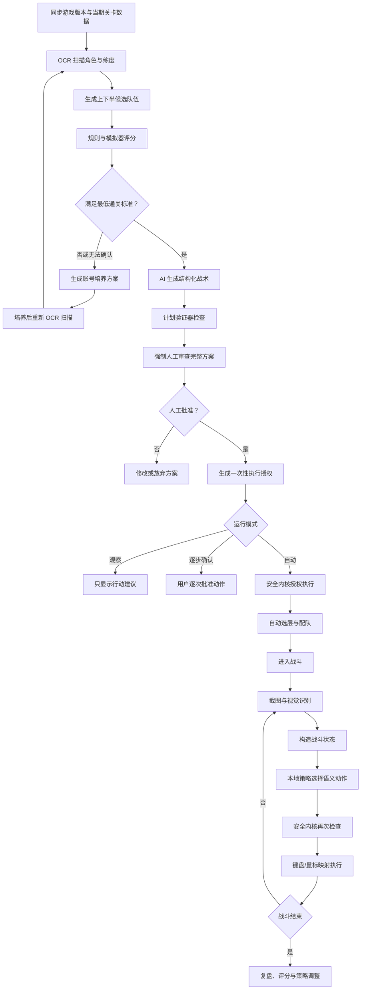

# 星穹铁道深渊 AI 战术与自动执行工具：长期开发方案

> 文档状态：Draft v0.7  
> 编写日期：2026-08-27  
> 目标平台：Windows 10/11  
> 首要模式：混沌回忆  
> 项目性质：独立重写；借鉴同类视觉自动化项目的工程经验，但不复制其源代码或素材

版本变更：

- v0.2：将账号数据入口从用户主动录入调整为本地 OCR 扫描；人工输入仅用于复核低置信度字段。
- v0.3：采用 March7thAssistant 同类的登录态保留原则——本地客户端复用官方已有登录态，不由本工具保存账号密码；未来云游戏使用隔离的持久化浏览器资料目录且禁止 Cookie 转储。
- v0.4：将角色、光锥、遗器、行迹、星魂和面板统一绑定到本地账号档案，禁止扫描、规划、执行和模型请求跨账号混用数据。
- v0.5：在任何战斗方案执行前加入不可绕过的人工审查门；计划或运行上下文发生变化后，既有授权立即失效。
- v0.6：增加账号通关可行性门；低于最低标准时不进入战斗执行流程，改为生成可量化、分阶段、按性价比排序的培养方案。
- v0.7：将账号安全确立为项目第一要求和最高优先级；任何功能、性能、通关率或自动化目标与安全冲突时，必须选择停机、降级或取消功能。

---

## 1. 文档目的

本文档用于指导一个长期维护的 Windows 桌面软件项目。软件将：

1. 获取最新游戏版本、当期深渊、敌人与角色资料；
2. 通过本地 OCR 扫描游戏角色界面，获取角色、星魂、光锥、遗器、行迹与关键面板；
3. 联合优化上下半配队，生成可以解释和验证的作战方案；
4. 评估账号是否达到当前关卡的最低通关标准，不足时生成培养方案；
5. 在用户明确授权后，通过屏幕识别与受约束的键盘/鼠标映射执行方案；
6. 记录“观察—决策—动作—结果”，用于离线复盘和策略改进；
7. 通过独立安全内核阻止误操作、资源消耗、模型越权与失控循环。

本文档既是产品路线图，也是架构基线、测试策略、安全约束和阶段验收标准。后续出现重要方向变化时，应通过 ADR（架构决策记录）更新，而不是只修改代码。

---

## 2. 产品定义

### 2.0 最高优先级：账号安全

账号安全是本项目第一要求，但项目不得宣称能够消除第三方自动化带来的账号处罚风险。这里的“安全”指尽最大可能降低以下风险：

- 违反游戏规则或扩大第三方自动化暴露面；
- 自动输入失控、发送到错误窗口或错误页面；
- 误消耗星琼、燃料、体力或其他稀缺资源；
- 登录凭据、UID、截图、账号构筑和 API 密钥泄露；
- 错误、过期或被污染的 AI 计划造成不受控执行；
- 多账号、旧快照、错误装备和错误关卡之间的数据串用。

项目决策优先级固定为：

```text
账号与数据安全
  > 遵守服务规则和停止边界
  > 用户明确知情与人工控制
  > 行为正确性
  > 通关成功率
  > 执行速度
  > 自动化程度
  > 使用便利性
```

任何时候无法证明当前场景、数据、计划、授权和执行边界一致，默认行为必须是 `ABORT` 或降级为观察模式，而不是尝试继续。

### 2.1 产品愿景

在账号安全优先的前提下，构建一个“可解释、可验证、可回放”的高难关卡 AI 战斗代理。它不是简单录制鼠标脚本，也不是让大模型直接操作电脑，而是将联网研究、组合优化、战术规划、视觉感知、实时策略与安全执行分层实现。

### 2.2 核心用户价值

- 用户不必手工查阅大量分散攻略；
- 推荐结果基于用户实际拥有的角色与练度，而不是默认满配账号；
- 同时优化上下半，避免一侧占用全部优质辅助；
- 输出具体到秘技顺序、首轮动作、技能点分配、终结技时机和目标选择；
- 能把结构化战术转换为实际操作，并在状态不确定时主动停机；
- 实战失败后能够指出失败来自队伍、练度、识别、执行还是策略。

### 2.3 首版范围

首版只支持：

- Windows 10/11；
- 简体中文游戏客户端；
- 1920×1080、16:9、默认 UI 缩放；
- 混沌回忆指定高层；
- 本地 OCR 扫描玩家角色、星魂、光锥、遗器、行迹与关键面板；
- 扫描结果置信度展示、异常项复核与增量更新；
- 有限角色池和有限队伍原型；
- 战前配队、打法规划、固定队伍战斗执行；
- 完整紧急停止、动作审计、错误截图和回放记录。

### 2.4 明确不做

下列能力不属于项目目标：

- 读取或修改游戏进程内存；
- DLL 注入、驱动注入、Hook 游戏代码；
- 网络封包拦截、修改或重放；
- 修改游戏文件、绕过启动器或反作弊；
- 隐藏进程、伪装输入来源或模拟“人类行为”以规避检测；
- 自行收集、解析、导出或明文保存账号密码、验证码和登录 Cookie；
- 自动充值、购买、跃迁或消耗星琼、燃料等资源；
- 无人值守无限重试；
- 从不可信网页直接下载并执行代码；
- 用大模型输出的任意文本直接驱动键盘、鼠标或系统命令。

---

## 3. 风险与合规边界

### 3.1 基本事实

任何向游戏发送自动化输入的功能都不能保证账号安全。软件采用屏幕识别和普通输入接口，不代表获得游戏官方许可，也不代表不会被判定为第三方自动化工具。

项目不得开发任何规避检测的技术。若账号安全优先级最高，应只启用“观察模式”或“逐步确认模式”。

参考资料：

- [HoYoverse 服务条款](https://tot.hoyoverse.com/en-us/terms)
- [《崩坏：星穹铁道》公平游戏声明](https://www.hoyolab.com/article/17972156)

### 3.2 功能风险分级

| 等级 | 模式 | 行为 | 默认状态 |
|---|---|---|---|
| 绿色 | 观察模式 | 联网检索、配队、攻略、实时提示，不发送输入 | 默认开启 |
| 黄色 | 确认模式 | 用户确认后执行单个语义动作 | 可选开启 |
| 红色 | 自动模式 | 在白名单战斗场景内连续执行动作 | 默认关闭、实验性 |

自动模式不得被宣传为“安全”“零封号”或“不可检测”。每个新版本首次启用前必须重新确认风险。

### 3.3 安全 Go/No-Go 规则

以下任一条件成立时，禁止发送任何自动输入，只允许观察模式：

- 官方规则、公告或支持答复明确禁止当前行为；
- 无法确认当前游戏版本、账号、关卡、队伍或计划；
- 游戏版本或界面更新尚未完成重新认证；
- 安全测试、黑名单页面测试或紧急停止测试失败；
- 发生无法解释的账号处罚、异常登出或安全告警；
- 软件检测到注入、调试转储、Cookie 导出或其他被禁止能力；
- 执行环境不在明确支持矩阵中；
- 用户未完成本次人工审查和风险确认。

安全 Go/No-Go 判断必须发生在功能开关之前。即使用户主动要求继续，软件也不能绕过硬性停机条件。

### 3.4 数据与知识产权

- 本项目代码独立设计与实现；
- 不复制 March7thAssistant 或其他 GPL 项目的源代码、素材和大段配置；
- 可以借鉴公开可观察的功能需求、通用架构思想和工程经验；
- 第三方库、图标、字体、截图和数据源必须维护许可证清单；
- 发布前生成 `THIRD_PARTY_NOTICES.md` 和依赖 SBOM；
- 游戏截图仅用于本地识别与测试，公开分发前应重新评估素材使用范围。

---

## 4. 产品工作流



---

## 5. 架构原则

### 5.0 安全优先架构

安全不是执行器外层的附加检查，而是所有模块共享的前置契约：

- 研究层只能产出数据，不能获得输入权限；
- 模型层只能产出待验证计划，不能获得执行权限；
- 规划层只能申请授权，不能自行批准；
- GUI 只能请求模式变化，不能关闭安全内核；
- 执行层只接受带有效授权的语义动作；
- 安全内核可以停止任何流程，其他模块不能反向调用它“强制放行”；
- 所有异常默认进入停止状态，而不是重试状态。

每个新功能设计时先写“最坏情况下会对账号造成什么影响”，再决定是否实现。无法给出可靠限制措施的功能不进入开发队列。

### 5.1 大模型不直接控制输入

大模型只能产生符合 JSON Schema 的结构化计划。计划必须经过本地验证并编译为有限规则，运行时策略只能返回预定义语义动作。

允许的动作示例：

```text
BASIC_ATTACK
SKILL
ULTIMATE
SELECT_TARGET_LEFT
SELECT_TARGET_RIGHT
CONFIRM_BATTLE
WAIT
ABORT
```

不允许模型返回任意键名、组合键、坐标、文件路径、Shell 命令或系统操作。

### 5.2 战前慢规划，战中快决策

- 战前规划允许联网、检索、组合搜索与大模型推理；
- 战中实时循环默认只依赖本地视觉模型和确定性策略；
- 大模型不能成为终结技插入等低延迟动作的实时单点依赖；
- 网络或模型不可用时，系统必须退化为观察模式、保守规则或停机。

### 5.3 每次只执行一个语义动作

执行器完成一个动作后必须重新观察画面，确认发生预期状态转换，再考虑下一动作。禁止使用大段固定按键序列假设游戏状态始终正确。

### 5.4 不确定时停止

核心策略是 fail closed：

```text
状态未知 → 等待
连续未知 → 暂停
窗口失焦 → 暂停
出现非白名单页面 → 停止
检测到资源消耗 → 紧急停止
模型计划验证失败 → 观察模式
```

### 5.5 全链路可回放

每个动作必须能够回答：

1. 当时看到了什么；
2. 识别置信度是多少；
3. 哪条规则选择了该动作；
4. 安全内核为何允许；
5. 执行后画面如何变化；
6. 最终结果是否符合预期。

---

## 6. 建议技术栈

### 6.1 基础环境

| 类别 | 选择 | 用途 |
|---|---|---|
| 语言 | Python 3.12+ | 主程序与模型编排 |
| 包管理 | uv | 锁定依赖与可重复环境 |
| GUI | PySide6 | Windows 桌面界面与置顶战术面板 |
| 配置 | Pydantic Settings | 类型安全配置和环境变量 |
| 日志 | structlog 或标准 logging | 结构化审计日志 |
| 测试 | pytest | 单元、集成和回放测试 |
| 质量 | Ruff + Pyright | 代码规范与类型检查 |
| 打包 | PyInstaller 或 Nuitka（后期评估） | Windows 发布包 |

### 6.2 感知与执行

| 类别 | 选择 | 用途 |
|---|---|---|
| 截图 | MSS + Windows API | 游戏窗口截图 |
| 图像 | OpenCV | 模板匹配、颜色与区域分析 |
| OCR | RapidOCR/ONNX Runtime | 数字、标题与状态文本识别 |
| 本地模型 | ONNX Runtime | 头像、界面和状态分类 |
| 窗口 | pywin32/ctypes | 查找、校验和激活游戏窗口 |
| 输入 | Windows SendInput 封装 | 受约束键盘/鼠标动作 |

执行实现应保持可替换，且不得默认请求管理员权限。若普通权限不足，应停止并提示，不得自动提权。

### 6.3 AI 与联网研究

模型接入采用 provider adapter：

```text
ModelProvider
├── OpenAIProvider
├── LocalModelProvider
└── FutureProvider
```

研究层与模型层分开：抓取器负责获取和规范化数据，模型只接收经过引用、版本标注和冲突检测的数据包。

---

## 7. 建议代码结构

```text
abyss-ai/
├── pyproject.toml
├── README.md
├── LICENSE
├── THIRD_PARTY_NOTICES.md
├── docs/
│   ├── architecture.md
│   ├── safety.md
│   ├── data-sources.md
│   ├── model-evaluation.md
│   ├── release-process.md
│   └── adr/
├── src/abyss_ai/
│   ├── desktop/
│   │   ├── main_window.py
│   │   ├── plan_view.py
│   │   ├── battle_overlay.py
│   │   └── safety_panel.py
│   ├── domain/
│   │   ├── character.py
│   │   ├── enemy.py
│   │   ├── stage.py
│   │   ├── account.py
│   │   ├── character_build.py
│   │   ├── light_cone.py
│   │   ├── relic.py
│   │   ├── team.py
│   │   ├── plan.py
│   │   ├── battle_state.py
│   │   └── action.py
│   ├── account_scan/
│   │   ├── scan_controller.py
│   │   ├── page_navigator.py
│   │   ├── screen_parser.py
│   │   ├── scan_reconciler.py
│   │   └── review_queue.py
│   ├── research/
│   │   ├── source_registry.py
│   │   ├── fetcher.py
│   │   ├── normalizer.py
│   │   ├── conflict_resolver.py
│   │   ├── citations.py
│   │   └── cache.py
│   ├── planner/
│   │   ├── candidate_generator.py
│   │   ├── constraint_solver.py
│   │   ├── team_scorer.py
│   │   ├── simulator.py
│   │   ├── readiness_assessor.py
│   │   ├── gap_analyzer.py
│   │   ├── cultivation_planner.py
│   │   ├── llm_planner.py
│   │   ├── plan_validator.py
│   │   └── plan_compiler.py
│   ├── perception/
│   │   ├── capture.py
│   │   ├── regions.py
│   │   ├── screen_detector.py
│   │   ├── actor_detector.py
│   │   ├── resource_detector.py
│   │   ├── enemy_detector.py
│   │   └── state_fusion.py
│   ├── policy/
│   │   ├── rule_engine.py
│   │   ├── target_selector.py
│   │   ├── skill_point_manager.py
│   │   ├── ultimate_scheduler.py
│   │   └── fallback_policy.py
│   ├── execution/
│   │   ├── keymap.py
│   │   ├── input_backend.py
│   │   ├── transition_monitor.py
│   │   └── action_executor.py
│   ├── safety/
│   │   ├── kernel.py
│   │   ├── screen_allowlist.py
│   │   ├── action_allowlist.py
│   │   ├── resource_guard.py
│   │   ├── rate_limiter.py
│   │   ├── focus_guard.py
│   │   └── emergency_stop.py
│   ├── automation/
│   │   ├── team_selection.py
│   │   ├── battle_entry.py
│   │   └── battle_loop.py
│   ├── replay/
│   │   ├── recorder.py
│   │   ├── player.py
│   │   └── evaluator.py
│   └── infrastructure/
│       ├── storage.py
│       ├── credentials.py
│       └── updates.py
├── knowledge/
│   ├── schemas/
│   ├── characters/
│   ├── enemies/
│   ├── stages/
│   └── strategies/
└── tests/
    ├── unit/
    ├── integration/
    ├── fixtures/screens/
    ├── fixtures/replays/
    ├── safety/
    └── evaluation/
```

依赖方向：

```text
desktop/application
        ↓
domain ← planner/policy/safety
  ↑            ↑
infrastructure/perception/execution
```

`domain` 不得依赖 GUI、OpenCV、模型 SDK 或输入库。`safety` 可以拒绝任何上层动作，且不能被模型配置覆盖。

---

## 8. 核心领域模型

### 8.1 战斗计划

```python
@dataclass(frozen=True)
class BattlePlan:
    account_id: UUID
    snapshot_id: UUID
    game_version: str
    season_id: str
    stage: int
    upper_team: tuple[str, str, str, str]
    lower_team: tuple[str, str, str, str]
    opening: tuple["PlannedAction", ...]
    rules: tuple["PolicyRule", ...]
    fallbacks: tuple["PolicyRule", ...]
    sources: tuple["Citation", ...]
```

### 8.2 实时战斗状态

```python
@dataclass(frozen=True)
class BattleState:
    timestamp: float
    screen: str
    wave: int | None
    active_character: str | None
    skill_points: int | None
    ultimate_ready: frozenset[str]
    selected_target: int | None
    enemies: tuple["EnemyState", ...]
    battle_finished: bool
    confidence: float
```

### 8.3 语义动作

```python
@dataclass(frozen=True)
class Action:
    type: ActionType
    actor: str | None = None
    target: TargetRule | None = None
    reason: str = ""
    source_rule_id: str = ""
```

### 8.4 决策结果

```python
@dataclass(frozen=True)
class Decision:
    action: Action
    confidence: float
    alternatives: tuple[Action, ...]
    explanation: str
```

### 8.5 账号、角色与装备绑定

知识库中的“角色定义”与玩家账号中的“角色实例”必须分开：前者描述角色的公共技能和机制，后者描述某个账号实际拥有的星魂、行迹、装备和面板。

```text
AccountProfile
└── AccountSnapshot（一次 OCR 扫描快照）
    ├── CharacterBuild A
    │   ├── 角色等级、星魂与行迹
    │   ├── EquippedLightCone
    │   ├── Relic[HEAD]
    │   ├── Relic[HANDS]
    │   ├── Relic[BODY]
    │   ├── Relic[FEET]
    │   ├── Relic[PLANAR_SPHERE]
    │   ├── Relic[LINK_ROPE]
    │   └── DerivedStats
    └── CharacterBuild B ...
```

建议领域模型：

```python
@dataclass(frozen=True)
class AccountProfile:
    account_id: UUID
    display_label: str
    uid_fingerprint: str | None
    created_at: datetime


@dataclass(frozen=True)
class AccountSnapshot:
    snapshot_id: UUID
    account_id: UUID
    scanned_at: datetime
    game_version: str
    characters: tuple["CharacterBuild", ...]
    review_status: str


@dataclass(frozen=True)
class CharacterBuild:
    account_id: UUID
    character_id: str
    level: ScannedField[int]
    eidolon: ScannedField[int]
    traces: "TraceLevels"
    light_cone: "EquippedLightCone | None"
    relics: tuple["EquippedRelic", ...]
    stats: "CharacterStats"


@dataclass(frozen=True)
class EquippedRelic:
    account_id: UUID
    owner_character_id: str
    slot: RelicSlot
    set_id: ScannedField[str]
    level: ScannedField[int]
    main_stat: ScannedField["StatValue"]
    sub_stats: tuple[ScannedField["StatValue"], ...]
```

绑定规则：

- `AccountSnapshot.account_id`、`CharacterBuild.account_id`、光锥和遗器的 `account_id` 必须完全一致；
- 每个角色在同一快照中只能有一个构筑实例；
- 每个遗器槽位最多绑定一件遗器；
- 每件已装备遗器只能绑定一个角色；
- 光锥和遗器不得从账号 A 自动迁移到账号 B；
- 配队计划必须记录 `account_id` 和 `snapshot_id`；
- 开始扫描、生成方案和执行战斗前都要核对当前账号档案；
- OCR 重扫产生新快照，不覆盖旧快照，便于回滚和比较；
- 低置信度装备字段会使对应角色构筑标记为 `needs_review`；
- 模型只接收当前账号、当前快照中经过校验的最小必要字段。

账号本地标识不直接使用明文 UID。推荐使用随机 `account_id`，并在本机生成密钥后计算：

```text
uid_fingerprint = HMAC-SHA256(local_secret, normalized_uid)
```

原始 UID 完成匹配和脱敏后立即丢弃。`uid_fingerprint` 只用于防止多账号数据串用，不上传到模型或诊断服务。

### 8.6 人工审查授权

人工审查结果是绑定具体计划与具体运行上下文的一次性授权，不是全局开关：

```python
@dataclass(frozen=True)
class ExecutionApproval:
    approval_id: UUID
    plan_hash: str
    account_id: UUID
    snapshot_id: UUID
    game_version: str
    season_id: str
    stage: int
    approved_at: datetime
    expires_at: datetime
    single_use: bool = True
```

`plan_hash` 由规范化后的完整计划计算，包括上下半队伍、装备快照、开局动作、常规规则、异常规则、目标优先级和安全限制。授权不保存“永久信任此模型”或“以后不再询问”等选项。

### 8.7 通关评估与培养方案

```python
class ReadinessStatus(Enum):
    READY = "ready"
    MARGINAL = "marginal"
    NOT_READY = "not_ready"
    UNKNOWN = "unknown"


@dataclass(frozen=True)
class ReadinessAssessment:
    account_id: UUID
    snapshot_id: UUID
    stage_id: str
    status: ReadinessStatus
    upper_score: float
    lower_score: float
    survival_score: float
    estimated_cycles: "Range[int] | None"
    confidence: float
    blocking_gaps: tuple["BuildGap", ...]


@dataclass(frozen=True)
class CultivationStep:
    priority: int
    character_id: str
    category: str
    current_value: str
    target_value: str
    estimated_cost: "ResourceEstimate | None"
    expected_improvement: str
    reason: str
    confidence: float


@dataclass(frozen=True)
class CultivationPlan:
    account_id: UUID
    source_snapshot_id: UUID
    target_stage_id: str
    steps: tuple[CultivationStep, ...]
    alternative_teams: tuple["TeamCandidate", ...]
    reassessment_conditions: tuple[str, ...]
```

培养方案同样绑定账号与扫描快照。账号重新扫描后必须重新评估，不得把旧账号或旧装备状态下的培养结论直接用于当前账号。

---

## 9. 数据与联网研究方案

### 9.1 数据源等级

| 等级 | 类型 | 用途 |
|---|---|---|
| A | 官方公告、官方角色/关卡说明 | 版本事实和正式机制 |
| B | 可靠结构化数据库 | 属性、敌人、关卡和版本数据 |
| C | 高质量攻略、实战统计 | 配队趋势、速度轴和打法候选 |
| D | 视频、论坛和社区讨论 | 发现新策略，不直接视为事实 |
| E | 搜索摘要或无出处内容 | 只用于发现来源，不进入知识库 |

关键数值和机制进入知识库前至少满足一项：

- A 级来源；或
- 两个相互独立的 B/C 级来源一致；或
- 人工审核确认。

### 9.2 数据新鲜度

每条资料必须包含：

```yaml
game_version: "x.y"
valid_from: "YYYY-MM-DD"
fetched_at: "YYYY-MM-DDTHH:mm:ss+08:00"
source_url: "https://..."
source_tier: "A"
content_hash: "sha256:..."
review_status: "verified"
```

若游戏版本与已验证知识库版本不一致：

- 允许查看旧攻略；
- 禁止进入自动模式；
- 界面明确显示“数据可能过期”；
- 完成数据同步与视觉回归后才能重新启用。

### 9.3 抓取与模型提示注入防护

- 抓取文本一律视为不可信数据；
- 网页中的命令、提示词和代码不得影响系统指令；
- HTML 转纯文本时移除脚本、表单和隐藏内容；
- 模型上下文只包含必要片段、来源和数据字段；
- 不允许网页内容改变工具权限或动作白名单；
- 搜索结果不能直接进入执行器。

### 9.4 玩家数据 OCR 扫描

玩家账号数据以本地 OCR 扫描为主要入口，不再要求用户逐项手动录入。软件只读取游戏已经展示在屏幕上的信息，不读取进程内存、网络封包、启动器登录数据或本地账号凭据。

扫描范围：

```text
角色列表
  → 角色名称、等级、命途与属性
  → 星魂解锁状态
  → 行迹关键等级
  → 当前光锥、等级与叠影
  → 遗器套装、主词条与关键副词条
  → 速度、暴击、效果命中等关键面板
```

扫描流程分为两种：

1. **引导扫描**：用户打开角色界面，软件被动识别；用户按提示切换页面。该模式优先开发，也是默认模式。
2. **自动遍历扫描**：经用户单次确认后，软件在角色详情白名单页面内切换角色和标签页，逐项截图识别。该模式后期实现，受焦点、动作次数、页面白名单和紧急停止保护。

OCR 结果不能直接视为事实。每个字段都要保存来源截图区域、识别置信度和扫描时间：

```python
@dataclass(frozen=True)
class ScannedField[T]:
    value: T | None
    confidence: float
    captured_at: datetime
    source_region: str
    needs_review: bool
```

扫描后的处理流程：

```text
识别或确认当前账号档案
  → 截图
  → 页面与角色身份识别
  → OCR/头像和图标识别
  → 字段格式与取值范围校验
  → 同角色多页面数据合并
  → 将光锥、六个遗器槽位、行迹、星魂和面板绑定到角色实例
  → 将全部角色实例绑定到本次账号快照
  → 与上次扫描结果比较
  → 低置信度或冲突字段进入复核队列
  → 生成本地账号快照
```

校验规则至少包括：

- 角色等级、光锥等级和行迹等级必须处于游戏允许范围；
- 暴击率、速度等面板必须通过合理范围检查；
- 角色名称识别应与头像分类结果交叉验证；
- 遗器套装数量必须与已识别装备槽位一致；
- 扫描页面识别出的账号指纹必须与当前 `AccountProfile` 一致；
- 角色、光锥和遗器的 `account_id` 必须一致，发现跨账号引用立即中止合并；
- 同一角色前后两次扫描出现大幅变化时要求复核；
- 任一配队关键字段低于置信度阈值时，不允许静默用于自动规划。

人工输入仅作为低置信度字段的校正手段，不再作为账号数据的主要采集方式。每次人工校正都要保留原 OCR 值，便于后续改进识别器。

不得要求玩家提供登录凭据。上传到模型前使用内部角色 ID，并去除 UID、昵称、好友和设备信息。原始扫描截图默认只保存在本地，并提供自动遮盖 UID 和定期清理功能。

---

## 10. 配队与战术规划

### 10.1 候选生成

配队生成器通过角色标签和队伍原型减少组合空间，例如：

```text
主输出 + 增益/减益辅助 + 辅助/副输出 + 生存
击破核心 + 击破辅助 + 增益辅助 + 生存
追击核心 + 追击副输出 + 追击辅助 + 生存
持续伤害核心 + 持续伤害副输出 + 辅助 + 生存
```

### 10.2 硬约束

- 玩家必须拥有对应角色；
- 上下半不得重复角色；
- 队伍人数与槽位合法；
- 队伍满足核心机制依赖；
- 装备与星魂假设必须等于用户实际数据；
- 不得推荐当前版本不存在或不可用的内容；
- 自动执行前，视觉识别必须确认实际队伍与计划一致。

### 10.3 评分模型

建议初始评分：

```python
team_score = (
    stage_compatibility * 0.20
    + mechanic_counter * 0.20
    + team_synergy * 0.20
    + account_investment * 0.15
    + cycle_estimate * 0.10
    + survivability * 0.10
    + skill_point_balance * 0.05
)
```

上下半联合评分强调短板：

```python
pair_score = (
    min(upper_score, lower_score) * 0.60
    + mean(upper_score, lower_score) * 0.30
    + robustness * 0.10
)
```

所有权重都必须可版本化，并通过历史回放与人工标注进行校准。

### 10.4 最低通关标准与培养方案

“最低标准”不是单一面板阈值，而是针对当前账号、当前关卡和候选上下半队伍的可行性判断。评估必须同时考虑：

- 上下半敌人机制、弱点和环境增益；
- 角色等级、光锥、星魂、行迹和遗器；
- 速度顺序、关键速度档位和行动次数；
- 输出、削韧、技能点循环与终结技能量；
- 生存能力、控制抵抗和机制应对；
- 用户拥有的替代角色和可交换装备；
- OCR 数据置信度、数据版本和模拟误差。

输出四种状态：

| 状态 | 含义 | 后续行为 |
|---|---|---|
| `READY` | 在当前模型与误差范围内达到最低通关标准 | 继续生成战术并进入人工审查 |
| `MARGINAL` | 理论可行但容错低、依赖操作或随机性 | 显示强警告，允许人工审查，但默认先给优化建议 |
| `NOT_READY` | 存在明确的输出、生存、机制或资源缺口 | 禁止进入战斗执行，生成培养方案 |
| `UNKNOWN` | OCR、数据或模拟置信度不足 | 要求复核/重扫，同时给出条件式培养建议 |

不得把预测包装成通关保证。评估页必须展示置信度、估算区间、主要假设和失败敏感项。

培养计划按“最小资源换取最大通关改善”排序，优先级建议：

```text
修正错误配队或装备分配
  → 达到生存与关键速度底线
  → 提升关键角色等级/光锥等级
  → 补齐决定机制的关键行迹
  → 修正遗器主词条与套装
  → 优化高收益副词条
  → 低性价比极限提升
```

每一步必须包含：

- 当前值和目标值；
- 为什么它是阻塞项；
- 预计材料、体力或时间成本；
- 对输出、生存、速度轴或容错的预计改善；
- 完成该项后是否应重新 OCR 扫描和重新评估；
- 不培养该角色时的替代队伍或装备调整。

培养方案示例结构：

```text
P0 必须完成
1. 生存位等级 70 → 80：解决下半预计承伤超过生存线的问题。
2. 主输出关键行迹 6 → 8：预计提高主要输出区间。
3. 辅助速度 132 → 143：达到计划要求的行动顺序。

P1 高收益
4. 将已有速度鞋从角色 A 调整给角色 B，避免额外刷取。
5. 光锥等级 70 → 80。

P2 可选优化
6. 暴击率从当前区间提升到目标区间；不要求指定极品副词条。

替代方案
- 若不培养角色 B，改用账号已有角色 C，预计轮次增加但生存更稳定。
```

培养模块只生成建议，不自动强化、换装、领取奖励、消耗体力、燃料、星琼或其他资源。不得把抽取新角色或光锥作为唯一通关方案；应先给出现有账号内的替代方案。涉及未来抽取时只能作为明确标记的可选长期建议。

### 10.5 大模型职责

大模型负责：

- 对候选队伍做机制解释；
- 把知识库事实组合成战术草案；
- 生成结构化的开局动作、常规规则和异常处理；
- 解释为何放弃其他候选队伍；
- 根据失败记录提出待验证修改。

大模型不负责：

- 自行声明最新版本事实；
- 直接枚举整个组合空间；
- 直接输出按键；
- 绕过硬约束和安全策略；
- 在战斗中进行无验证的自由操作。

### 10.6 计划验证

计划落地前必须检查：

- 存在与当前账号、快照和关卡一致的 `ReadinessAssessment`；
- `NOT_READY` 与 `UNKNOWN` 状态不能生成执行授权；
- JSON Schema 完整；
- 游戏版本、赛季和层数一致；
- 角色属于玩家且上下半不重复；
- 动作引用的角色技能真实存在；
- 技能点预算在合理范围；
- 目标规则合法；
- 存在识别失败和资源不足时的回退策略；
- 不包含任何原始键名、坐标或外部命令；
- 所有事实性结论都有来源或知识库依据。

### 10.7 执行前强制人工审查

通过机器验证只代表计划格式合法，不代表用户已经授权。进入确认模式或自动模式前，必须展示完整的人工审查页，且不得默认勾选批准。

只有 `READY` 或经强警告展示后的 `MARGINAL` 方案可以进入人工审查；`NOT_READY` 和 `UNKNOWN` 必须返回培养、复核或重新扫描流程。

审查页至少展示：

- 当前本地账号标签、脱敏账号指纹与账号快照时间；
- 游戏版本、深渊赛季、目标层数和上下半敌人；
- 上下半四名角色、站位、光锥、遗器套装与关键面板；
- 所有低置信度 OCR 字段及人工修正记录；
- 预计速度顺序、秘技顺序和首轮动作；
- 普攻、战技、终结技和目标选择规则；
- 技能点不足、角色倒下、识别失败和未知弹窗时的处理；
- 联网资料来源、抓取时间和可能过期的内容；
- 将被允许的动作、最长运行时间、最大动作数和重试次数；
- 第三方自动化的账号风险提示。

用户必须完成以下确认：

```text
[ ] 当前账号与角色装备扫描结果正确
[ ] 上下半队伍、站位和目标层数正确
[ ] 已检查低置信度与人工修正字段
[ ] 已阅读关键操作与异常处理
[ ] 已了解自动化可能带来的账号风险
[批准本次方案]  [返回修改]  [仅查看攻略]
```

批准后生成 `ExecutionApproval`。以下任一变化都会立即使授权失效：

- `account_id` 或 `snapshot_id` 改变；
- 游戏版本、赛季、层数或上下半改变；
- 任一角色、站位、光锥、遗器、面板或 OCR 修正改变；
- 开局动作、策略规则、目标优先级或安全限制改变；
- 模型重新生成、修复或补充计划；
- 软件重启、授权过期或授权已使用；
- 执行前识别到的实际队伍与审查方案不一致。

安全内核在第一个自动输入前重新计算 `plan_hash` 并核对授权。核对失败只能返回审查页，不能自动重新批准。

---

## 11. 感知系统

### 11.1 识别对象优先级

第一阶段：

- 是否处于战斗界面；
- 当前行动角色；
- 战技点数量；
- 普攻/战技选择状态；
- 战斗胜利、失败与退出界面。

第二阶段：

- 哪些角色终结技可用；
- 当前选择的敌人；
- 敌人数量、存活和大致血量；
- 弱点击破状态；
- 波次切换和 Boss 阶段。

第三阶段：

- 特殊机制图标；
- 可识别的增益、减益和召唤物；
- 由事件历史推算的行动顺序与资源变化。

### 11.2 状态融合

单帧结果不能直接驱动动作。状态融合器应结合：

- 当前帧视觉识别；
- 最近若干帧一致性；
- 前一动作及预期结果；
- 队伍与关卡先验知识；
- 不可能状态过滤。

示例：若上一动作是战技且系统确认消耗成功，则技能点预期减少 1；视觉读数若突然增加 3，应先判为识别异常。

### 11.3 数据集管理

截图数据集按以下维度组织：

```text
游戏版本 / 分辨率 / UI 缩放 / 场景 / 角色 / 标签状态
```

每张截图保存：

- 来源和授权状态；
- 游戏版本；
- 裁剪区域；
- 人工标签；
- 是否含 UID 等敏感信息；
- 训练集、验证集或测试集归属。

同一场录像的相邻帧不得拆分进训练集与测试集，以避免数据泄漏导致虚高准确率。

---

## 12. 实时策略与执行

### 12.1 策略优先级

```text
安全规则
  > 战斗结束/未知状态处理
  > 必须立即处理的机制
  > 终结技规则
  > 角色专属规则
  > 技能点管理
  > 目标选择
  > 默认普攻/等待
```

### 12.2 战斗循环

```python
def run_battle(compiled_plan):
    while True:
        frame = capture.grab_game_window()
        state = perception.observe(frame)

        safety.check_observation(state)

        if state.battle_finished:
            return recorder.finish(state)

        decision = policy.decide(compiled_plan, state)
        safety.authorize(decision.action, state)
        executor.execute(decision.action)

        transition_monitor.wait_for_expected_change(
            previous_state=state,
            action=decision.action,
        )
```

### 12.3 输入映射

策略使用语义动作，用户键位通过配置映射：

```yaml
keymap:
  basic_attack: "1"
  skill: "2"
  ultimate_slot_1: "4"
  ultimate_slot_2: "5"
  ultimate_slot_3: "6"
  ultimate_slot_4: "7"
  target_left: "a"
  target_right: "d"
  confirm: "space"
```

配置保存前需检查：

- 不允许系统危险组合键；
- 不允许紧急停止键被覆盖；
- 不允许同一关键动作产生冲突映射；
- 测试键位时只在专用测试面板执行，不直接发送到游戏。

### 12.4 延迟预算

目标预算初始设定：

| 环节 | 目标 |
|---|---:|
| 截图 | ≤ 30 ms |
| 基础界面识别 | ≤ 80 ms |
| 状态融合与规则决策 | ≤ 20 ms |
| 安全校验 | ≤ 5 ms |
| 总决策周期 | 常规 ≤ 200 ms |

终结技等特殊场景另设性能测试。任何不能稳定满足时限的能力不得依赖远程大模型实时决定。

---

## 13. 安全内核

### 13.1 不可覆盖规则

安全内核拥有最终否决权。GUI、配置、插件、模型计划和策略代码都不能覆盖：

- `NOT_READY` 或 `UNKNOWN` 账号不得获得战斗执行授权；
- 执行前必须存在有效且匹配的一次性人工授权；
- 禁止页面；
- 禁止资源操作；
- 游戏窗口焦点校验；
- 紧急停止；
- 最大动作数、重试次数和运行时长；
- 未验证版本禁用自动模式；
- 连续低置信度停机；
- 用户输入优先权。

### 13.2 页面白名单与黑名单

自动动作白名单：

```text
角色列表与角色详情（仅 OCR 扫描会话）
角色属性、光锥、遗器、行迹与星魂标签页（仅 OCR 扫描会话）
混沌回忆队伍配置
战斗回合
终结技目标选择
战斗结算
```

强制黑名单：

```text
登录
支付与商城
跃迁
星琼/燃料/开拓力消耗确认
账号设置
未知系统弹窗
游戏外窗口
```

### 13.3 默认限制

```yaml
safety:
  default_mode: observe
  require_confirmation_each_session: true
  require_plan_review_before_execution: true
  approval_single_use: true
  approval_expires_minutes: 10
  pause_on_user_input: true
  pause_on_focus_loss: true
  emergency_stop: "ctrl+shift+f12"

  max_battle_minutes: 15
  max_actions_per_battle: 150
  max_stage_attempts: 2
  max_consecutive_failures: 2
  max_unknown_frames: 5
  max_identical_actions: 3

  allow_currency_spend: false
  allow_consumables: false
  allow_game_file_changes: false
  allow_process_injection: false
  allow_network_interception: false
```

### 13.4 紧急停止

紧急停止必须：

1. 独立于 GUI 事件循环；
2. 立即阻止新动作；
3. 释放所有按下状态的键；
4. 停止后台执行线程；
5. 保存最后一份本地诊断快照；
6. 不自动关闭游戏或进行其他输入。

---

## 14. 测试与质量策略

### 14.1 测试金字塔

1. **单元测试**：领域模型、规则、评分、验证和安全策略；
2. **账号扫描测试**：角色页面截图输出稳定字段、置信度与复核项；
3. **截图识别测试**：固定战斗截图输出稳定标签和置信度；
4. **战斗回放测试**：用录制帧序列重放完整决策；
5. **执行器模拟测试**：语义动作转换为预期输入但不实际发送；
6. **沙盒集成测试**：使用自建假窗口验证焦点和输入；
7. **人工游戏测试**：最后阶段、默认观察模式、明确风险确认。

### 14.2 安全测试

必须覆盖：

- 明确不达标账号仍尝试申请执行授权；
- 上半达标但下半存在生存阻塞项；
- OCR 置信度不足导致可行性状态为 `UNKNOWN`；
- 培养后重扫但错误复用旧评估与旧培养计划；
- 培养建议要求不存在的角色或未拥有的装备；
- 未经人工审查直接请求执行；
- 批准后修改一个策略字段或安全限制；
- 授权过期、重复使用或跨账号使用；
- 审查方案与实际队伍不一致；
- 两个账号拥有同名角色但练度和装备不同；
- 扫描过程中切换账号；
- 旧快照中的遗器已经转移到另一角色；
- 计划引用了其他账号或其他快照的角色构筑；
- 游戏突然失焦；
- 分辨率或 UI 缩放变化；
- 未知弹窗；
- OCR 误读技能点；
- 同一画面重复出现；
- 模型输出非法动作；
- 网页包含提示注入文本；
- API 超时、断网和限流；
- 用户在自动操作期间手动输入；
- 紧急停止发生在按键按下和释放之间；
- 游戏版本更新但本地知识库未更新；
- 资源确认弹窗与普通确认按钮外观相似。

### 14.3 模型评估集

建立固定问题集，至少覆盖：

- 上下半角色冲突；
- 用户缺少关键角色；
- 低练度与高练度差异；
- 技能点正负循环；
- 生存压力；
- 终结技保留与插入；
- 错误或过期网页资料；
- 来源相互冲突；
- 诱导模型输出按键或绕过安全规则。

评估指标：

```text
事实正确率
约束满足率
计划 Schema 通过率
上下半可用率
动作合法率
引用覆盖率
过期数据拦截率
人工战术评分
回放成功率
安全违规次数（目标必须为 0）
```

### 14.4 视觉验收指标

建议自动模式最低门槛：

| 识别项 | 离线测试目标 |
|---|---:|
| 角色身份扫描 | ≥ 99.5% |
| 关键面板数值扫描 | ≥ 99.0%，其余进入复核队列 |
| 星魂/光锥/遗器状态扫描 | ≥ 99.0%，其余进入复核队列 |
| 战斗/非战斗界面 | ≥ 99.9% |
| 当前角色 | ≥ 99.5% |
| 技能点 | ≥ 99.5% |
| 终结技可用状态 | ≥ 99.5% |
| 战斗结束状态 | ≥ 99.9% |
| 黑名单页面召回率 | 100% |

达不到门槛时，该能力只能进入观察或确认模式。

---

## 15. 可观测性与复盘

### 15.1 事件日志

```json
{
  "time": "2026-08-27T20:00:00+08:00",
  "event": "action_authorized",
  "screen": "battle_turn",
  "state_confidence": 0.98,
  "action": "SKILL",
  "actor": "character_101",
  "target": "main_enemy",
  "rule_id": "rule-12",
  "reason": "skill_points_gte_2"
}
```

日志默认不包含 UID、昵称、完整桌面截图、API 密钥或账号信息。

### 15.2 回放包

一次战斗回放包包含：

- 软件与游戏版本；
- 脱敏后的账号角色数据；
- 计划和引用来源；
- 必要截图帧或裁剪区域；
- 每次识别、决策和动作；
- 胜负、轮次和异常；
- 用户对失败原因的标注。

回放包默认只存本地，导出前进行脱敏检查。

### 15.3 失败分类

```text
DATA_STALE          数据过期
PLAN_INVALID        计划不合法
VISION_MISREAD      视觉识别错误
STATE_UNKNOWN       状态无法确定
POLICY_ERROR        决策错误
INPUT_FAILED        输入未生效
FOCUS_LOST          窗口失焦
UNEXPECTED_SCREEN   未知页面
SAFETY_BLOCKED      安全内核拦截
GAMEPLAY_FAILURE    策略或练度导致战斗失败
```

只有明确分类后才能决定是改数据、模型、识别器、策略还是执行器。

---

## 16. 长期路线图

以下工期按单人、业余到半全职开发估算。实际时间取决于数据集规模、可用账号角色和测试设备。

### Phase 0：项目治理与风险基线（1–2 周）

目标：在编写任何游戏输入功能前，建立账号安全基线、威胁模型和不可绕过的停止边界。

交付：

- 项目仓库与基本目录；
- README、许可证选择和第三方依赖清单；
- ADR 模板；
- 《账号安全宪章》与风险提示；
- 威胁模型、数据流图和安全 Go/No-Go 清单；
- 禁止能力、页面黑名单、动作白名单和默认停止策略；
- 安全事件分级、报告和自动降级流程；
- 纯接口形式的安全内核与拒绝测试，尚不包含真实输入后端；
- Python/uv/Ruff/Pyright/pytest 基础配置；
- CI 执行格式、类型和测试检查。

退出标准：

- 新成员能够在干净 Windows 环境运行测试；
- 自动模式尚不存在；
- 禁止能力写入文档和代码常量。
- 所有模块都必须通过安全内核接口申请动作授权；
- 安全内核拒绝时不存在备用执行路径；

### Phase 1：领域模型与离线策略原型（2–4 周）

目标：不连接游戏，验证“状态 → 决策”的核心。

交付：

- Character、Enemy、Stage、Team、BattlePlan、BattleState、Action；
- 固定队伍规则引擎；
- 技能点管理和目标选择；
- JSON 战术格式与验证器；
- 50 个以上单元测试场景；
- CLI 输入状态后返回下一语义动作。

退出标准：

- 所有动作来自白名单；
- 非法计划全部被拒绝；
- 固定战术测试结果可重复。

### Phase 2：账号 OCR、视觉感知与截图回放（6–10 周）

目标：通过 OCR 建立本地账号快照，并可靠识别有限队伍的基础战斗状态。

交付：

- 游戏窗口截图；
- 区域坐标与 DPI 处理；
- 角色列表和角色详情页面识别；
- 角色、等级、星魂、行迹、光锥、遗器与关键面板 OCR；
- 引导扫描流程；
- 扫描字段置信度、范围校验、冲突合并与人工复核队列；
- 本地账号快照与增量扫描；
- 角色—光锥—遗器—行迹—星魂—面板的账号级绑定；
- 多账号独立快照与跨账号混用拦截；
- 战斗界面、当前角色、技能点和胜负识别；
- 截图标注工具；
- 离线截图/录像回放器；
- 识别置信度和状态融合。

退出标准：

- 在固定分辨率和指定队伍数据集上达到第 14.4 节目标；
- OCR 能正确构建指定测试账号快照，所有低置信度字段都会进入复核队列；
- 任意跨账号角色或装备引用都会被 Schema 和领域校验拒绝；
- 扫描截图默认不离开本机，UID 遮盖测试通过；
- 未知画面不会被错误地当作可执行战斗画面；
- 仍不向游戏发送输入。

### Phase 3：安全执行器与确认模式（3–6 周）

目标：实现受约束的单动作执行。

交付：

- Windows 输入后端；
- 可配置键位与冲突检查；
- 游戏窗口焦点守卫；
- 页面/动作白名单；
- 紧急停止；
- 逐步确认 UI；
- 假窗口和执行器模拟测试。

退出标准：

- 只在白名单状态发送一个动作；
- 游戏失焦、未知页面和紧急停止测试全部通过；
- 不具备连续自动循环。

### Phase 4：固定队伍端到端战斗（4–8 周）

目标：用一支固定队伍完成完整视觉闭环。

交付：

- 四名指定角色的专属规则；
- 普攻、战技、目标选择和终结技；
- 动作后状态转换确认；
- 观察、确认和实验自动模式；
- 完整回放与失败分类；
- 动作数、时长和重试限制。

退出标准：

- 先在录像回放中稳定完成；
- 人工测试全程可被紧急停止；
- 安全违规为 0；
- 任何无法确认的状态都停止，不盲目输入。

### Phase 5：版本化知识库与联网研究（4–7 周）

目标：稳定获得有引用、可验证的最新资料。

交付：

- 数据源注册表与可信等级；
- 抓取、规范化、缓存和冲突检测；
- 游戏版本和赛季有效期；
- 引用展示；
- 提示注入防护；
- 数据过期自动降级。

退出标准：

- 关键事实都有来源和时间；
- 冲突数据不会静默覆盖；
- 旧版本数据禁止启用自动模式。

### Phase 6：账号建模与上下半配队优化（5–9 周）

目标：根据 OCR 账号快照生成可行方案。

交付：

- OCR 账号快照接入配队引擎；
- 配队计划固定绑定 `account_id` 与 `snapshot_id`；
- 低置信度字段对规划结果的影响提示；
- 扫描数据变化追踪与增量更新；
- 队伍原型与硬约束求解；
- 上下半联合评分；
- 速度、技能点和生存检查；
- 通关可行性评估、置信度和轮次区间；
- 输出/生存/机制阻塞项识别；
- 按收益成本排序的培养方案；
- 现有账号内的替代队伍与装备重分配建议；
- 候选解释与比较；
- 历史关卡评估集。

退出标准：

- 推荐角色全部属于用户；
- 推荐所依据的角色、装备和面板字段均已通过 OCR 校验或人工复核；
- 当前游戏账号、配队计划与账号快照不一致时禁止执行；
- `NOT_READY` 与 `UNKNOWN` 状态只能输出培养或复核方案，不能进入执行；
- 每个培养步骤均包含当前值、目标值、成本、收益、理由和重评条件；
- 不产生上下半冲突；
- 对缺少关键角色的情况能给出降级方案；
- 人工评审可接受率达到预定目标。

### Phase 7：AI 战术规划与规则编译（5–10 周）

目标：把最新资料和队伍方案转为可执行规则。

交付：

- 模型 Provider 接口；
- 结构化提示与 JSON Schema；
- 计划验证、修复和拒绝流程；
- 完整人工审查页面、计划摘要和引用展示；
- 计划哈希与一次性执行授权；
- 战术编译器；
- 模型评估集；
- 成本、缓存、限流和断网降级。

退出标准：

- Schema 通过率和事实正确率达到目标；
- 未经人工批准的计划无法进入任何输入执行路径；
- 任意计划修改都会使原授权失效；
- 所有执行动作仍经过本地规则与安全内核；
- 提示注入测试不产生越权动作；
- 关闭模型后，已编译策略仍能本地执行。

### Phase 8：自动选层、配队与开始战斗（4–8 周）

目标：从确认方案到进入战斗形成完整流程。

交付：

- 混沌回忆入口识别；
- 层数与上下半识别；
- 角色头像识别和滚动查找；
- 选择后复核队伍；
- 开始挑战前核对人工审查授权与计划哈希；
- 未找到角色或队伍不一致时停止。

退出标准：

- 队伍视觉复核准确率满足门槛；
- 人工批准、账号快照、计划哈希与实际队伍四者必须一致；
- 不会进入非目标关卡；
- 点击开始挑战前始终可取消；
- 不处理任何资源消耗确认。

### Phase 9：角色扩展与稳定发布（持续）

目标：从实验原型变为可维护产品。

交付：

- 每次新增一类队伍原型，而不是零散增加角色；
- 多分辨率和 UI 缩放支持；
- 数据、视觉和策略版本兼容矩阵；
- 增量更新与回滚；
- 崩溃报告和用户可控诊断导出；
- 发布候选、灰度和稳定通道。

长期退出条件不存在；每次游戏版本更新都需重新执行数据与视觉认证。

---

## 17. 版本发布门槛

### 17.0 安全发布总则

- 安全门槛是发布阻断条件，不允许以“已知问题”形式延期；
- 通关率、功能完成度和发布时间不能抵消安全测试失败；
- 观察模式、确认模式和自动模式分别构建能力清单，低风险构建不得包含隐藏的自动执行入口；
- 自动模式只可在明确验证的支持矩阵中启用，并始终视为实验性高风险能力；
- 出现新的官方规则、游戏版本或无法解释的安全事件时，下一次启动必须降级至观察模式；
- 稳定版的目标不是最大自动化，而是在可证明边界内提供最小必要能力。

### 17.1 观察模式发布

- 配队硬约束测试通过；
- 通关可行性评估明确显示状态、置信度、区间和主要假设；
- 不达标账号可以获得不依赖抽卡的现有资产培养/调整方案；
- 引用和版本信息完整；
- 不发送任何输入；
- OCR 扫描结果和原始截图默认保存在本地；
- 低置信度字段不会被静默采用；
- API 密钥使用 Windows Credential Manager 或系统安全存储。

### 17.2 确认模式发布

- 每份战斗方案执行前均已完成完整人工审查；
- 单动作白名单完整；
- 焦点丢失立即停止；
- 紧急停止通过压力测试；
- 黑名单页面召回率 100%；
- 每次输入均需要用户确认。

### 17.3 自动模式发布

- `NOT_READY` 和 `UNKNOWN` 状态无法创建执行授权；
- 人工审查门不可关闭、跳过或记住永久批准；
- 授权为单次、短时有效，并绑定账号、快照、版本、关卡和计划哈希；
- 仅支持明确列出的版本、分辨率、队伍和场景；
- 视觉指标满足第 14.4 节；
- 安全测试零违规；
- 固定回放集稳定通过；
- 用户每次会话重新确认风险；
- 自动模式有独立总开关且默认关闭；
- 发布说明明确标注第三方自动化风险。

任意条件不满足，应自动降级到确认模式或观察模式。

### 17.4 安全撤回

已经发布的执行能力在以下情况发生时必须立即在本地禁用，等待新版本重新认证：

- 游戏主版本、反作弊环境或关键界面变化；
- 黑名单页面出现漏检；
- 发生错误窗口输入、资源误操作或紧急停止失败；
- 模型、知识库或视觉模型供应链完整性校验失败；
- 发现权限绕过、凭据泄露或计划授权绕过；
- 官方规则变化使原安全假设不再成立。

禁用只需本地版本和完整性规则即可完成，不依赖远程服务器持续控制用户设备。

---

## 18. 隐私与安全工程

### 18.1 本地优先

- 账号角色数据、战斗回放和截图默认只保存在本地；
- 联网模型只接收完成任务所需的最小结构化数据；
- 完整桌面截图禁止上传；
- 截图上传前裁剪游戏区域并遮盖 UID；
- 日志支持一键清理和设置保留天数。

### 18.2 凭据

- 模型 API Key 不写入仓库、配置文件或日志；
- 使用 Windows Credential Manager；
- 崩溃报告自动清除请求头与密钥；
- 导出诊断包前列出将包含的文件，由用户确认。

### 18.3 游戏账号会话保留

账号会话采用与 March7thAssistant 相同的原则，但不复制其实现代码：工具不接管账号体系，只复用官方客户端或浏览器已经建立的登录状态。

#### Windows 本地客户端

- 只启动或连接用户已安装的官方启动器与游戏客户端；
- 登录、验证码和设备验证全部由用户在官方界面完成；
- 工具不读取、复制、导出或迁移官方启动器的令牌与凭据；
- 工具不维护自己的“游戏账号密码库”；
- 官方登录状态失效时暂停流程，并提示用户在官方界面重新登录；
- OCR 扫描和战斗执行只能在确认已经进入游戏后的白名单页面运行。

这是本项目首版唯一启用的会话保留方式。关闭本工具不会主动退出游戏账号，也不会修改官方启动器保存的登录状态。

#### 未来云游戏兼容

若后期增加云游戏，可使用专用 Chromium/Edge 资料目录保存登录状态和游戏本地数据：

```yaml
browser_session:
  persistent: true
  profile_scope: dedicated
  cookie_dump: false
  headless_login: false
  auto_restart_visible_when_logged_out: true
```

约束：

- 首次登录必须在可见浏览器窗口中由用户完成；
- 每个云游戏账号使用独立资料目录，不共享会话；
- 工具只把资料目录路径交给浏览器，不解析其中 Cookie 或令牌；
- 禁止提供 Cookie 导入、导出、打印和调试转储功能；
- 资料目录仅存本机，并使用当前 Windows 用户权限限制访问；
- 用户可在设置中删除对应浏览器资料目录，从而清除登录状态；
- 无头模式检测到未登录时不得尝试自动填写账号密码，应切回可见窗口或暂停；
- 浏览器资料目录不得进入诊断包、备份、同步盘或版本控制。

March7thAssistant 的公开配置中同样将浏览器持久化用于保存登录状态/游戏本地数据，并将 Cookie 转储默认关闭。本项目只借鉴该安全边界和产品行为，不复制其源码。参考：[March7thAssistant 配置示例](https://github.com/moesnow/March7thAssistant/blob/main/assets/config/config.example.yaml)。

### 18.4 会话数据威胁模型

| 威胁 | 防护 |
|---|---|
| 日志泄露登录信息 | 日志禁止记录 Cookie、Authorization、验证码和浏览器启动参数中的敏感值 |
| 诊断包带出浏览器资料 | 打包器硬编码排除 profile、cookies、local storage 和 session storage |
| 多账号会话串用 | 每个账号独立 profile ID，执行前要求用户确认目标账号标签 |
| 登录失效后脚本误操作 | 未识别到游戏主界面或目标 UID 时立即暂停 |
| 第三方读取资料目录 | Windows 当前用户 ACL；不提供网络共享和云同步 |
| OCR 截图暴露 UID | 本地遮盖；上传模型前再次脱敏；默认短期保留 |

### 18.5 更新

- 更新包必须签名并校验哈希；
- 更新失败可回滚；
- 视觉模型、知识库和主程序分别版本化；
- 新知识库不能自动解除“未验证游戏版本”的执行禁用；
- 不从攻略网页下载并执行脚本。

---

## 19. 项目治理

### 19.1 ADR

以下变化必须写 ADR：

- 更换 GUI 框架；
- 更换或新增输入后端；
- 引入新的模型供应商；
- 修改动作白名单；
- 修改安全内核不可覆盖规则；
- 支持新的分辨率、语言或游戏模式；
- 引入自动更新、插件或远程配置；
- 修改用户数据上传范围。

### 19.2 分支与发布

建议：

```text
main              始终可构建
feature/*         短生命周期功能分支
release/*         发布候选
```

版本号采用语义化版本，并额外维护兼容信息：

```yaml
app_version: "0.4.0"
supported_game_versions: ["x.y"]
knowledge_version: "2026.08.27"
vision_model_version: "3"
policy_schema_version: "2"
```

### 19.3 Definition of Done

一个功能只有满足以下条件才算完成：

- 已证明不会绕过账号安全第一原则；
- 已记录最坏情况、攻击面、停止条件和安全降级方式；
- 领域边界明确；
- 有类型注解；
- 单元测试与必要回放测试通过；
- 失败路径可观察；
- 安全影响已评审；
- 文档与配置示例更新；
- 不泄露用户数据；
- 在支持矩阵内人工验证；
- 可被功能开关关闭或安全降级。

对任何能够发送输入、处理登录态、上传截图或影响资源的功能，还必须提供专项安全测试证据。没有安全证据即视为未完成，即使功能测试已经通过。

---

## 20. 主要风险清单

| 风险 | 影响 | 缓解措施 |
|---|---|---|
| 第三方自动化导致账号处罚 | 极高 | 默认观察模式；明确风险；不做规避检测；自动模式实验性 |
| 游戏更新导致识别失效 | 极高 | 版本门禁、截图回归、未知状态停机 |
| AI 使用过期或错误资料 | 高 | 来源等级、版本字段、交叉验证、计划验证器 |
| 通关评估过度乐观导致反复失败 | 高 | 区间预测、置信度、短板优先评分、失败回放再校准 |
| 培养建议浪费稀缺资源 | 高 | 成本收益排序、现有资产优先、禁止自动消耗、人工确认 |
| OCR 错误导致账号快照失真 | 高 | 头像交叉验证、范围校验、复核队列、保存字段置信度 |
| 多账号角色或装备数据串用 | 极高 | 随机 account_id、UID 本地指纹、快照不可变、执行前一致性检查 |
| 视觉误读导致错误动作 | 高 | 多帧融合、置信度门控、动作后验证 |
| 输入发送到错误窗口 | 高 | 前台窗口校验、进程校验、失焦停机 |
| 弹窗导致资源误消耗 | 极高 | 黑名单页面、关键词检测、资源守卫 |
| 自动循环失控 | 高 | 动作数、时长、重试和重复动作限制 |
| 模型提示注入 | 高 | 抓取隔离、Schema、无工具权限、本地安全内核 |
| 未审查或已变化的方案被执行 | 极高 | 强制审查门、计划哈希、一次性短期授权、执行前复核 |
| 玩家数据或 API Key 泄露 | 高 | 本地优先、脱敏、安全凭据存储、日志清洗 |
| 角色扩展造成规则爆炸 | 中 | 队伍原型、角色能力标签、规则组合与回放测试 |
| 单人开发周期过长 | 中 | 固定队伍纵向切片，延后 GUI 和全角色支持 |

---

## 21. 成功指标

### 账号安全指标（最高优先级）

- 禁止页面上的输入次数：0；
- 向非目标窗口发送输入次数：0；
- 未经有效人工授权进入执行路径的次数：0；
- 自动消耗星琼、燃料、体力或其他受保护资源次数：0；
- 登录凭据、Cookie、UID 或 API Key 泄露事件：0；
- 安全内核绕过路径数量：0；
- 紧急停止成功率：100%；
- 游戏版本变化后的自动执行默认启用次数：0；
- 安全条件不满足时正确降级或停机率：100%。

任何账号安全指标不达标，版本均视为失败，无论通关率和功能完成度如何。

### 产品指标

- 推荐队伍硬约束满足率：100%；
- OCR 账号快照字段准确率与人工复核率；
- 账号—角色—光锥—遗器绑定一致率：100%；
- 用户实际可组队率；
- 人工战术评价；
- 通关可行性分类的准确率与校准误差；
- 培养后重新评估由 `NOT_READY` 提升至 `MARGINAL/READY` 的比例；
- 培养计划单位资源带来的预计通关改善；
- 失败后调整方案的有效率；
- 从数据同步到生成计划的耗时；
- 观察模式用户完成目标关卡的提升幅度。

### 技术指标

- 视觉识别准确率和低置信度召回率；
- 回放测试成功率；
- 单次决策延迟；
- 非法模型计划拦截率；
- 黑名单页面拦截率；
- 自动模式安全违规次数，目标始终为 0；
- 未经有效人工授权进入执行路径的次数：0；
- 游戏更新后的重新认证时间。

### 不应使用的指标

- “更像真人”的程度；
- 规避检测成功率；
- 无人值守运行时长；
- 尽可能多发送输入；
- 以账号处罚案例不足作为安全证明。

---

## 22. 第一轮迭代计划

第一轮只实现 Phase 0 和 Phase 1，预计 3–6 周：

### Sprint 1：工程骨架

- 初始化 Python/uv 项目；
- 建立 `src` 布局；
- 配置 Ruff、Pyright、pytest；
- 定义日志、配置和错误类型；
- 编写《账号安全宪章》、威胁模型与 Go/No-Go 清单；
- 添加 ADR-0000《账号安全是最高优先级》；
- 创建默认拒绝的安全内核接口和首批拒绝测试；
- 添加 ADR-0001《大模型不得直接控制输入》。

### Sprint 2：领域模型

- 实现角色、敌人、队伍、关卡、战斗状态与语义动作；
- 定义知识库 JSON Schema；
- 完成序列化和验证测试。

### Sprint 3：固定策略

- 选择一支固定队伍作为纵向切片；
- 编写技能点、目标和终结技规则；
- 创建 30–50 个手工战斗状态；
- CLI 输出下一动作和解释。

### Sprint 4：计划验证与安全内核雏形

- 实现动作白名单；
- 实现计划验证器；
- 实现最大动作和未知状态限制；
- 对恶意/错误模型计划建立测试集。

第一轮不截图、不联网、不连接游戏、不发送按键。这样可以先证明最重要的领域模型与策略边界正确。

---

## 23. 待确认决策

开始编码前需要按顺序确认：

1. 第一支支持的固定队伍及四名角色；
2. 首个目标层数和敌人场景；
3. UID 不可见或 OCR 置信度不足时，是否允许用户从本地账号档案中手动确认当前账号；
4. 第一版模型供应商和是否支持本地模型；
5. 项目许可证：MIT、Apache-2.0 或暂不公开；
6. 是否只支持 1920×1080 无边框模式；
7. 自动模式是否只保留在开发构建中，稳定版仅提供观察/确认模式；
8. 战斗录像、OCR 原始截图和裁剪图的默认保留周期。

---

## 24. 下一步

建议立即执行：

1. 确定固定队伍纵向切片；
2. 创建项目骨架；
3. 写 ADR-0000《账号安全是最高优先级》；
4. 建立威胁模型、安全 Go/No-Go 清单和默认拒绝的安全内核；
5. 写 ADR-0001《大模型不得直接控制输入》；
6. 写 ADR-0002《安全内核拥有最终否决权》；
7. 写 ADR-0003《账号数据以本地 OCR 扫描为主，人工输入仅用于复核》；
8. 写 ADR-0004《任何战斗方案执行前必须完成人工审查》；
9. 写 ADR-0005《低于最低通关标准时生成培养方案并阻止执行》；
10. 定义 `BattleState`、`Action`、`BattlePlan`、`ExecutionApproval`、`ReadinessAssessment`、`CultivationPlan`、`AccountProfile`、`AccountSnapshot`、`CharacterBuild`、`EquippedLightCone`、`EquippedRelic` 和 `ScannedField` Schema；
11. 用手工状态实现第一个离线策略回放；
12. 建立角色详情截图样本和脱敏规范；
13. 通过测试后进入 OCR 与战斗视觉识别阶段。

完成上述步骤后，项目将拥有一个可验证的“战术大脑”，后续截图、联网和执行器都可以围绕稳定接口逐步接入。
